# BÁO CÁO BÀI TẬP CUỐI KHÓA

## PHẦN 1: TRIỂN KHAI KUBERNETES CLUSTER

### 1.1. Tài liệu cài đặt & File cấu hình
- **Công cụ triển khai:** Kubespray (Ansible) trên 2 máy ảo Multipass (Ubuntu 22.04 LTS):
  - **Master Node (`master1`):** `10.97.0.2` (Control Plane, etcd)
  - **Worker Node (`worker1`):** `10.97.0.116` (Worker Node)
- **Container Runtime:** `containerd` | **CNI Plugin:** Calico
- **File cấu hình Inventory:** [01-k8s-setup/hosts.yaml](./01-k8s-setup/hosts.yaml)

### 1.2. Ảnh chụp Log kiểm tra hệ thống

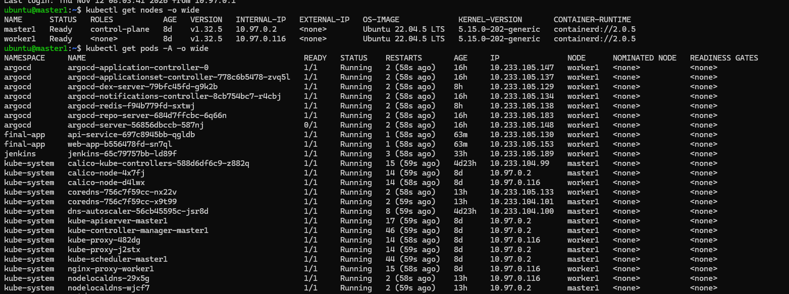

---

## PHẦN 2: K8S HELM CHART & GITOPS VỚI ARGOCD

### 2.1. Yêu cầu 1: Cài đặt ArgoCD và Jenkins (Expose qua NodePort)
- **File manifest triển khai ArgoCD:** [02-devops-tools/jenkins/argocd-install.yaml](./02-devops-tools/jenkins/argocd-install.yaml) & [02-devops-tools/jenkins/argocd-nodeport.yaml](./02-devops-tools/jenkins/argocd-nodeport.yaml) (`NodePort: 30124`)
- **File manifest triển khai Jenkins:** [02-devops-tools/jenkins/jenkins.yaml](./02-devops-tools/jenkins/jenkins.yaml) (`NodePort: 32080`)

#### Ảnh chụp giao diện ArgoCD:
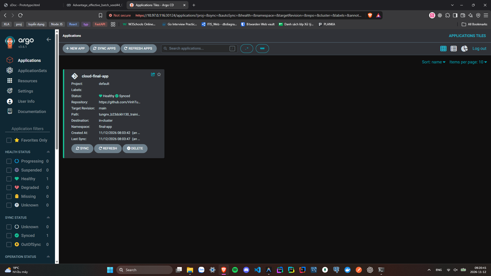

#### Ảnh chụp giao diện Jenkins
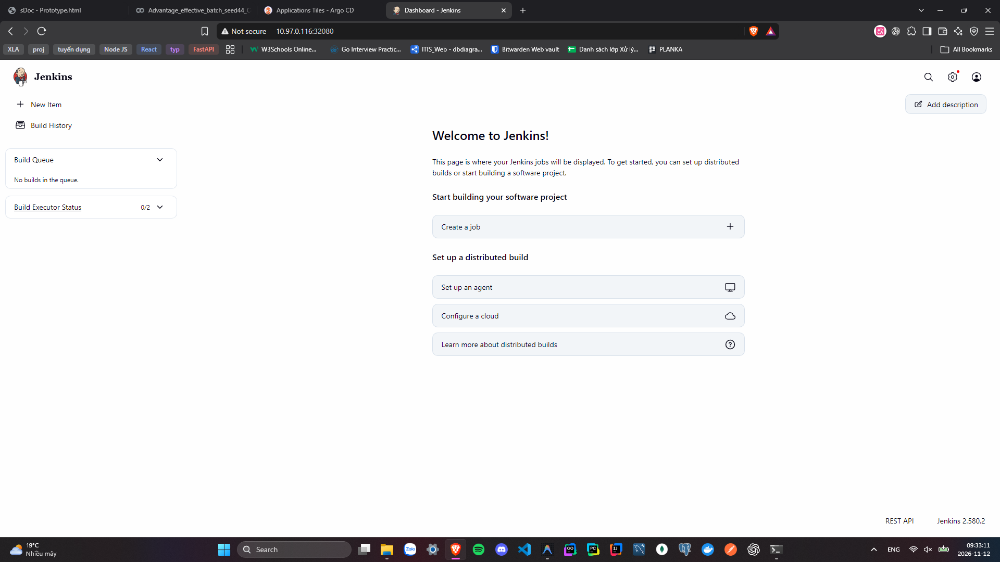

---

### 2.2. Yêu cầu 2: Helm Chart, Config Repo và ArgoCD Application
- **Thư mục Helm Chart của App:** [03-app-repo/helm-chart/](./03-app-repo/helm-chart/)
  - [Chart.yaml](./03-app-repo/helm-chart/Chart.yaml)
  - [values.yaml](./03-app-repo/helm-chart/values.yaml)
  - [templates/api.yaml](./03-app-repo/helm-chart/templates/api.yaml)
  - [templates/web.yaml](./03-app-repo/helm-chart/templates/web.yaml)
  - [templates/ingress.yaml](./03-app-repo/helm-chart/templates/ingress.yaml)
- **File `values.yaml` trong Config Repo:** [04-config-repo/values.yaml](./04-config-repo/values.yaml)
- **Manifest của ArgoCD Application:** [02-devops-tools/jenkins/argocd-app.yaml](./02-devops-tools/jenkins/argocd-app.yaml)

#### Ảnh chụp giao diện hệ thống ArgoCD trên trình duyệt:
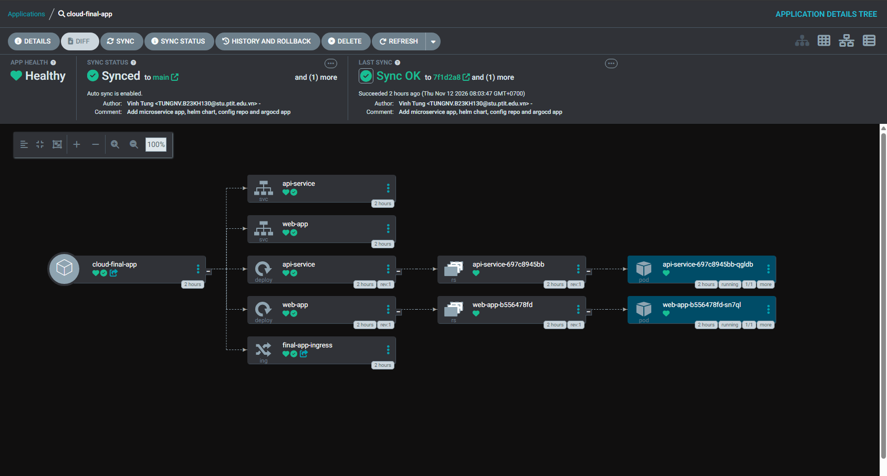

#### Ảnh chụp trình duyệt khi truy cập vào Web URL (`http://10.97.0.116:30880`):
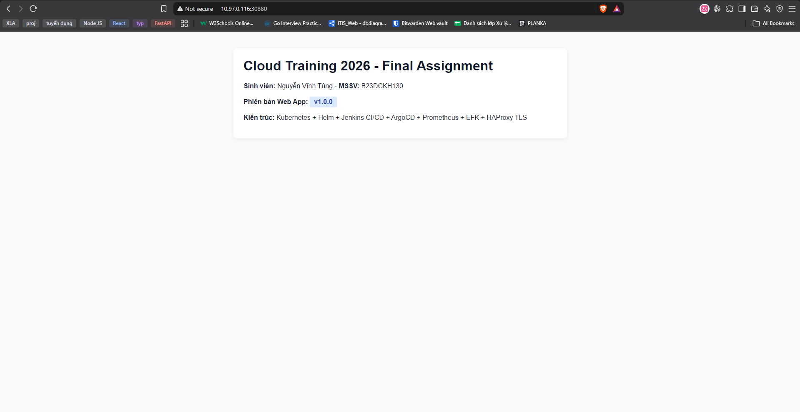

#### Ảnh chụp trình duyệt khi truy cập vào API URL (`http://10.97.0.116:30300/metrics`):
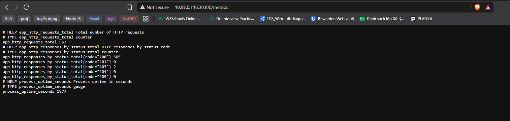

---

## PHẦN 3: LUỒNG CI/CD TỰ ĐỘNG VỚI JENKINS & ARGOCD

### 3.1. Các file setup công cụ của luồng CI/CD
- **File cấu hình Pipeline:** [03-app-repo/Jenkinsfile](./03-app-repo/Jenkinsfile)
- **Quy trình tự động:** Khi tạo Git Tag mới trên repo -> Jenkins tự động build Docker image cho `web-app` và `api-service` theo tên tag -> Push image lên Docker Hub (`vinhtung/cloud-final-web`, `vinhtung/cloud-final-api`) -> Cập nhật version trong [04-config-repo/values.yaml](./04-config-repo/values.yaml) và push lên GitHub -> ArgoCD tự động phát hiện thay đổi và rollout lại ứng dụng.

### 3.2. Kết quả chạy luồng CI/CD

#### Output log của luồng CI/CD trên Jenkins khi tạo tag mới:
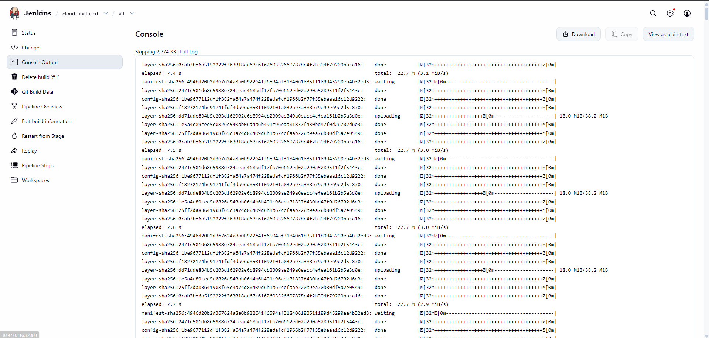

#### Ảnh luồng CI/CD chạy qua các Stage trên giao diện Jenkins (Pipeline Stage View):
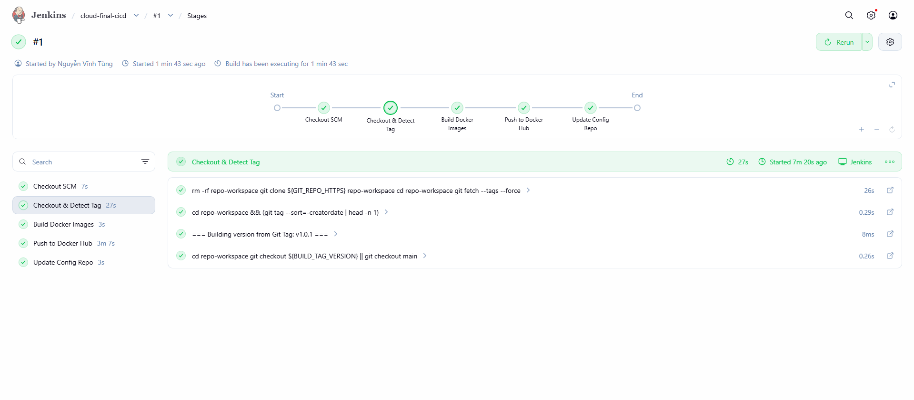

#### Hình ảnh App triển khai ArgoCD & màn hình DIFF khi phát hiện thay đổi ở Config Repo:
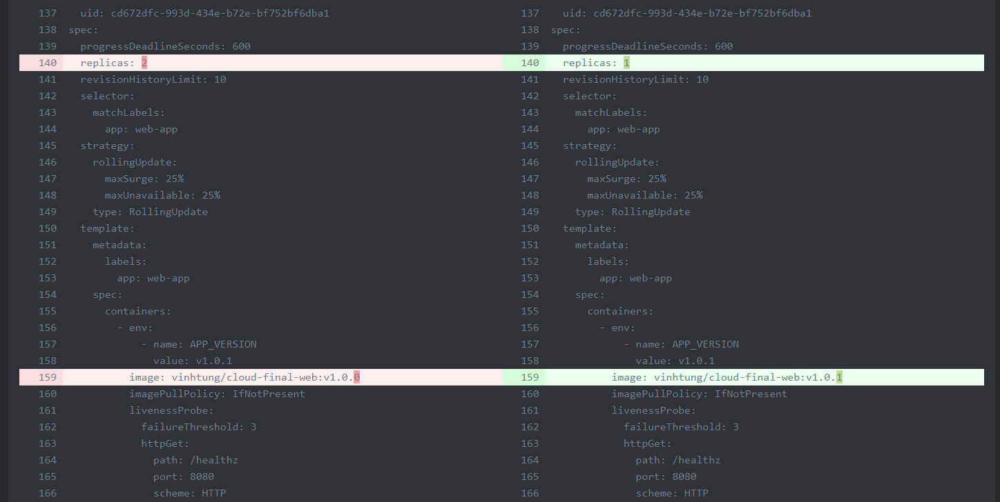

#### Hình ảnh App trước khi sửa code và sau khi sửa code:

---

## PHẦN 4: GIÁM SÁT HỆ THỐNG - MONITORING VỚI PROMETHEUS (1.5 ĐIỂM)

### 4.1. Các file setup triển khai Prometheus
- **Mã nguồn expose `/metrics`:** [03-app-repo/api-service/server.js](./03-app-repo/api-service/server.js) và [03-app-repo/web-app/server.js](./03-app-repo/web-app/server.js)
- **Ansible Playbook triển khai Prometheus:** [05-monitoring/deploy-prometheus.yaml](./05-monitoring/deploy-prometheus.yaml)
- **File cấu hình Prometheus:** [05-monitoring/prometheus.yml](./05-monitoring/prometheus.yml)

### 4.2. Kết quả giám sát trên Prometheus

#### Hình ảnh khi truy cập vào Prometheus UI thông qua trình duyệt:
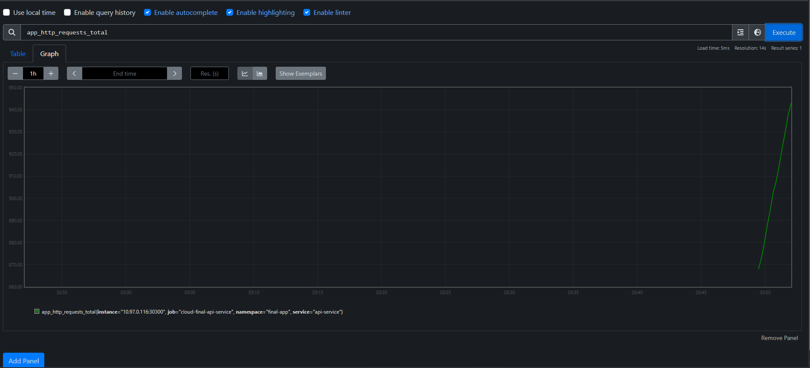

#### Hình ảnh danh sách Target của App được giám sát bởi Prometheus (`Status -> Targets`):
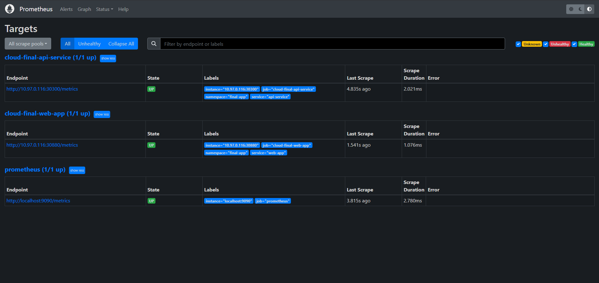

---

## PHẦN 5: THU THẬP LOG TẬP TRUNG - LOGGING VỚI EFK STACK (1.5 ĐIỂM)

### 5.1. Các file setup triển khai EFK Stack
- **Cấu hình Structured Log (`request_path`, `http_method`, `response_code`):** [03-app-repo/api-service/server.js](./03-app-repo/api-service/server.js)
- **Ansible Playbook triển khai EFK Stack:** [06-logging/deploy-efk.yaml](./06-logging/deploy-efk.yaml)

### 5.2. Kết quả tìm kiếm Log trên Kibana

#### Hình ảnh chụp màn hình Kibana kết quả tìm kiếm log của các service theo URL path:
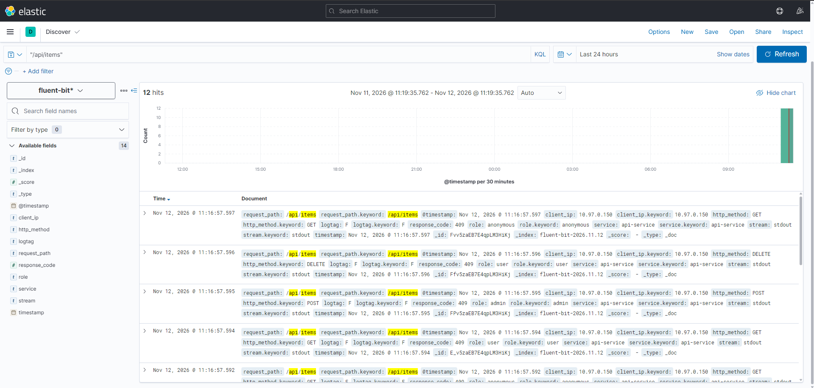

---

## PHẦN 6: BẢO MẬT HỆ THỐNG - SECURITY (3.0 ĐIỂM)

### 6.1. Yêu cầu 1 (1.0đ): HAProxy Load Balancer (Mode TCP) & Ingress HTTPS
- **File cấu hình HAProxy Load Balancer (Mode TCP):** [07-security/haproxy.cfg](./07-security/haproxy.cfg)
- **File cấu hình Ingress HTTPS (Self-signed Certificate):** [03-app-repo/helm-chart/templates/ingress.yaml](./03-app-repo/helm-chart/templates/ingress.yaml)

#### Kết quả truy cập vào App qua giao thức HTTPS (trình duyệt hoặc `curl`):
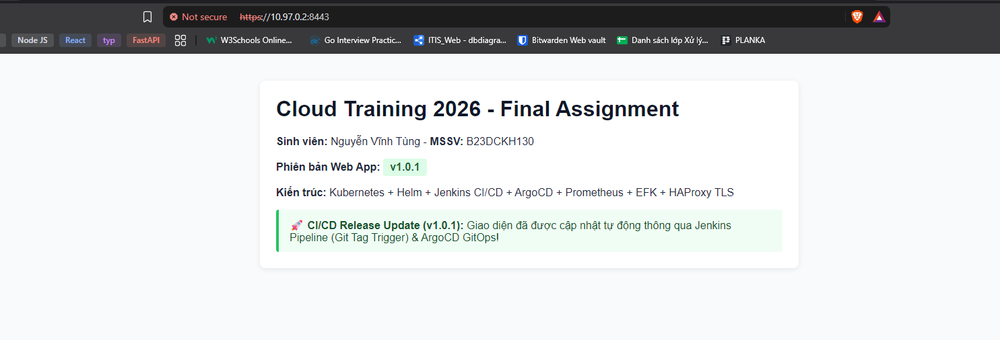

---

### 6.2. Yêu cầu 2 (1.0đ): Xác thực (Authentication) & Phân quyền RBAC (`user` vs `admin`)
- **Giải pháp thực hiện:** Tích hợp middleware xác thực Basic Auth / Bearer Token trong [03-app-repo/api-service/server.js](./03-app-repo/api-service/server.js):
  - Không truyền thông tin xác thực: trả về `HTTP 403 Forbidden`.
  - Role `user` (`-u user:user123`): `GET` trả về `200 OK`, `POST` / `DELETE` trả về `403 Forbidden`.
  - Role `admin` (`-u admin:admin123`): `GET` trả về `200 OK`, `POST` trả về `201 Created`, `DELETE` trả về `200 OK`.

#### Kết quả HTTP Response khi gọi API không xác thực và khi dùng quyền `user` / `admin`:
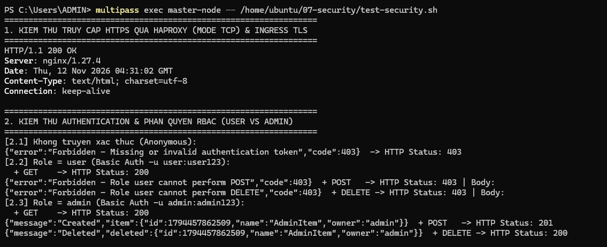

---

### 6.3. Yêu cầu 3 (1.0đ): Rate Limiting (> 10 requests/phút -> HTTP 409)
- **Giải pháp thực hiện:** Sử dụng thuật toán Sliding Window Counter (cửa sổ 60 giây, tối đa 10 requests/phút) trong [03-app-repo/api-service/server.js](./03-app-repo/api-service/server.js). Khi vượt quá 10 requests trong 1 phút, các request tiếp theo bị chặn và trả về `HTTP 409 Conflict`.

#### Kết quả thử nghiệm khi gọi quá 10 requests trong 1 phút vào Endpoint của API Service:
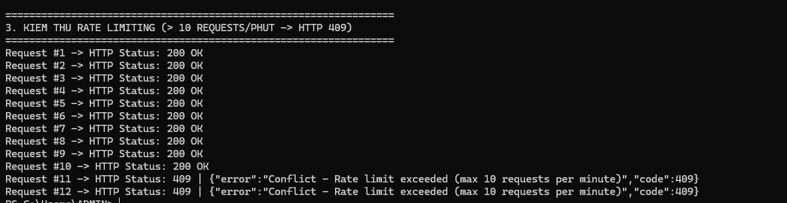
