# BÁO CÁO TỔNG HỢP TOÀN TẬP KIẾN THỨC VÀ THỰC HÀNH KUBERNETES (K8S)

- **Họ và tên:** Nguyễn Vĩnh Tùng
- **Mã sinh viên:** B23DCKH130
- **Chương trình đào tạo:** TYP Cloud Training 2026
- **Giai đoạn:** Giai đoạn 1 (`training-gd1`)
- **Chủ đề:** Toàn tập kiến thức chuyên sâu về Kubernetes (K8s) - Từ Kiến trúc lõi, Workloads, Networking, Storage, Security, Scheduling, GitOps đến Vận hành & Khắc phục sự cố (Troubleshooting)
- **Tài liệu tham chiếu:** Kubernetes Official Documentation (v1.28 - v1.31), CNCF Cloud Native Interactive Landscape
- **Thư mục báo cáo:** [K8s/REPORT.md](file:///d:/typ-training-cloud-2026/tungnv_b23dckh130_training-gd1/K8s/REPORT.md)

---

## MỤC LỤC TỔNG QUAN

- [**PHẦN 1: BỐI CẢNH, LỊCH SỬ VÀ TRIẾT LÝ CỦA CONTAINER ORCHESTRATION**](#phần-1-bối-cảnh-lịch-sử-và-triết-lý-của-container-orchestration)
  - [1.1. Sự phát triển từ Bare-metal, Virtual Machine đến Container](#11-sự-phát-triển-từ-bare-metal-virtual-machine-đến-container)
  - [1.2. Thách thức quản trị Container ở quy mô lớn (Container at Scale)](#12-thách-thức-quản-trị-container-ở-quy-mô-lớn-container-at-scale)
  - [1.3. Lịch sử hình thành Kubernetes: Từ Borg, Omega đến CNCF](#13-lịch-sử-hình-thành-kubernetes-từ-borg-omega-đến-cncf)
  - [1.4. Triết lý cốt lõi: Khai báo trạng thái (Declarative) vs Thực thi mệnh lệnh (Imperative)](#14-triết-lý-cốt-lõi-khai-báo-trạng-thái-declarative-vs-thực-thi-mệnh-lệnh-imperative)
  - [1.5. Vòng lặp điều hòa trạng thái (Reconciliation Loop / Control Loop)](#15-vòng-lặp-điều-hòa-trạng-thái-reconciliation-loop--control-loop)
- [**PHẦN 2: KIẾN TRÚC TỔNG THỂ KUBERNETES (K8S ARCHITECTURE DEEP DIVE)**](#phần-2-kiến-trúc-tổng-thể-kubernetes-k8s-architecture-deep-dive)
  - [2.1. Sơ đồ kiến trúc phân tán Master - Worker](#21-sơ-đồ-kiến-trúc-phân-tán-master---worker)
  - [2.2. Các thành phần Control Plane (Master Node)](#22-các-thành-phần-control-plane-master-node)
    - [2.2.1. kube-apiserver: Trái tim và cổng giao tiếp duy nhất](#221-kube-apiserver-trái-tim-và-cổng-giao-tiếp-duy-nhất)
    - [2.2.2. etcd: Kho dữ liệu phân tán Key-Value và thuật toán Raft Consensus](#222-etcd-kho-dữ-liệu-phân-tán-key-value-và-thuật-toán-raft-consensus)
    - [2.2.3. kube-scheduler: Cơ chế đánh giá và phân bổ Pod](#223-kube-scheduler-cơ-chế-đánh-giá-và-phân-bổ-pod)
    - [2.2.4. kube-controller-manager: Tập hợp các bộ điều khiển tự phục hồi](#224-kube-controller-manager-tập-hợp-các-bộ-điều-khiển-tự-phục-hồi)
    - [2.2.5. cloud-controller-manager: Cầu nối hạ tầng điện toán đám mây](#225-cloud-controller-manager-cầu-nối-hạ-tầng-điện-toán-đám-mây)
  - [2.3. Các thành phần Worker Node](#23-các-thành-phần-worker-node)
    - [2.3.1. kubelet: Đặc phái viên thực thi trên máy trạm](#231-kubelet-đặc-phái-viên-thực-thi-trên-máy-trạm)
    - [2.3.2. kube-proxy: Bộ định tuyến mạng và quản lý Service IP](#232-kube-proxy-bộ-định-tuyến-mạng-và-quản-lý-service-ip)
    - [2.3.3. Container Runtime & Chuẩn giao tiếp CRI (containerd, CRI-O)](#233-container-runtime--chuẩn-giao-tiếp-cri-containerd-cri-o)
  - [2.4. Các Add-on thiết yếu trong Cụm](#24-các-add-on-thiết-yếu-trong-cụm)
    - [2.4.1. CoreDNS: Hệ thống phân giải tên miền nội bộ](#241-coredns-hệ-thống-phân-giải-tên-miền-nội-bộ)
    - [2.4.2. Metrics Server: Cung cấp chỉ số hiệu năng phục vụ Autoscaling](#242-metrics-server-cung-cấp-chỉ-số-hiệu-năng-phục-vụ-autoscaling)
    - [2.4.3. CNI Plugin: Hạ tầng mạng phẳng](#243-cni-plugin-hạ-tầng-mạng-phẳng)
  - [2.5. Sơ đồ chuỗi toàn diện: Vòng đời khởi tạo một Pod từ A-Z qua toàn bộ các thành phần](#25-sơ-đồ-chuỗi-toàn-diện-vòng-đời-khởi-tạo-một-pod-từ-a-z-qua-toàn-bộ-các-thành-phần)
- [**PHẦN 3: CÁC ĐỐI TƯỢNG VÀ TÀI NGUYÊN TÍNH TOÁN CỐT LÕI (CORE WORKLOADS)**](#phần-3-các-đối-tượng-và-tài-nguyên-tính-toán-cốt-lõi-core-workloads)
  - [3.1. Pod: Nguyên tử cơ bản của Kubernetes](#31-pod-nguyên-tử-cơ-bản-của-kubernetes)
    - [3.1.1. Bản chất của Pod và lý do K8s không chạy trực tiếp Container đơn lẻ](#311-bản-chất-của-pod-và-lý-do-k8s-không-chạy-trực-tiếp-container-đơn-lẻ)
    - [3.1.2. Mối quan hệ giữa Pause Container và việc chia sẻ Namespace](#312-mối-quan-hệ-giữa-pause-container-và-việc-chia-sẻ-namespace)
    - [3.1.3. Mô hình Multi-Container: Sidecar, Init Container, Adapter và Ambassador](#313-mô-hình-multi-container-sidecar-init-container-adapter-và-ambassador)
    - [3.1.4. Vòng đời của Pod (Pod Lifecycle) và các trạng thái (Pod Phase)](#314-vòng-đời-của-pod-pod-lifecycle-và-các-trạng-thái-pod-phase)
    - [3.1.5. Cơ chế kiểm tra sức khỏe: Startup, Liveness và Readiness Probes](#315-cơ-chế-kiểm-tra-sức-khỏe-startup-liveness-và-readiness-probes)
    - [3.1.6. Quản lý tài nguyên: Request, Limit và các lớp QoS (Guaranteed, Burstable, BestEffort)](#316-quản-lý-tài-nguyên-request-limit-và-các-lớp-qos-guaranteed-burstable-besteffort)
  - [3.2. ReplicaSet: Đảm bảo số lượng bản sao mong muốn](#32-replicaset-đảm-bảo-số-lượng-bản-sao-mong-muốn)
  - [3.3. Deployment: Quản trị phiên bản và chiến lược nâng cấp ứng dụng](#33-deployment-quản-trị-phiên-bản-và-chiến-lược-nâng-cấp-ứng-dụng)
    - [3.3.1. Nguyên lý hoạt động và quản lý ReplicaSet ngầm](#331-nguyên-lý-hoạt-động-và-quản-lý-replicaset-ngầm)
    - [3.3.2. Chiến lược RollingUpdate (maxSurge, maxUnavailable) vs Recreate](#332-chiến-lược-rollingupdate-maxsurge-maxunavailable-vs-recreate)
    - [3.3.3. Truy vết lịch sử và Rollback ứng dụng](#333-truy-vết-lịch-sử-và-rollback-ứng-dụng)
  - [3.4. StatefulSet: Dành riêng cho ứng dụng có trạng thái (Stateful Workloads)](#34-statefulset-dành-riêng-cho-ứng-dụng-có-trạng-thái-stateful-workloads)
    - [3.4.1. Thách thức của Stateful Application trong môi trường phân tán](#341-thách-thức-của-stateful-application-trong-môi-trường-phân-tán)
    - [3.4.2. Định danh mạng duy nhất và vai trò của Headless Service](#342-định-danh-mạng-duy-nhất-và-vai-trò-của-headless-service)
    - [3.4.3. volumeClaimTemplates và cơ chế gắn kết Storage độc lập](#343-volumeclaimtemplates-và-cơ-chế-gắn-kết-storage-độc-lập)
    - [3.4.4. Thứ tự khởi tạo và hủy diệt Pod (OrderedReady vs Parallel)](#344-thứ-tự-khởi-tạo-và-hủy-diệt-pod-orderedready-vs-parallel)
  - [3.5. DaemonSet: Đảm bảo phủ sóng toàn bộ máy trạm](#35-daemonset-đảm-bảo-phủ-sóng-toàn-bộ-máy-trạm)
  - [3.6. Job và CronJob: Điều phối tác vụ hàng loạt và định kỳ](#36-job-và-cronjob-điều-phối-tác-vụ-hàng-loạt-và-định-kỳ)
- [**PHẦN 4: KIẾN TRÚC MẠNG KUBERNETES TOÀN TẬP (K8S NETWORKING DEEP DIVE)**](#phần-4-kiến-trúc-mạng-kubernetes-toàn-tập-k8s-networking-deep-dive)
  - [4.1. Bốn mô hình giao tiếp mạng cơ bản](#41-bốn-mô-hình-giao-tiếp-mạng-cơ-bản)
  - [4.2. Chuẩn CNI (Container Network Interface) và các CNI Plugin nổi tiếng](#42-chuẩn-cni-container-network-interface-và-các-cni-plugin-nổi-tiếng)
  - [4.3. Kubernetes Service: Cầu nối cân bằng tải nội bộ](#43-kubernetes-service-cầu-nối-cân-bằng-tải-nội-bộ)
  - [4.4. Cơ chế hoạt động của kube-proxy (iptables vs IPVS vs eBPF)](#44-cơ-chế-hoạt-động-của-kube-proxy-iptables-vs-ipvs-vs-ebpf)
  - [4.5. Ingress Controller và Gateway API: Cổng vào L7 cho thế giới bên ngoài](#45-ingress-controller-và-gateway-api-cổng-vào-l7-cho-thế-giới-bên-ngoài)
  - [4.6. NetworkPolicy: Tường lửa cấp vi mô bảo vệ Pod](#46-networkpolicy-tường-lửa-cấp-vi-mô-bảo-vệ-pod)
- [**PHẦN 5: QUẢN LÝ CẤU HÌNH VÀ LƯU TRỮ DỮ LIỆU (STORAGE & CONFIGURATION)**](#phần-5-quản-lý-cấu-hình-và-lưu-trữ-dữ-liệu-storage--configuration)
  - [5.1. Quản trị cấu hình: ConfigMap và Secret](#51-quản-trị-cấu-hình-configmap-và-secret)
  - [5.2. Kiến trúc lưu trữ Kubernetes: Volume, PV, PVC và StorageClass](#52-kiến-trúc-lưu-trữ-kubernetes-volume-pv-pvc-và-storageclass)
  - [5.3. Chuẩn CSI (Container Storage Interface)](#53-chuẩn-csi-container-storage-interface)
- [**PHẦN 6: ĐIỀU PHỐI LẬP LỊCH, BẢO VỆ TẢI VÀ TỰ ĐỘNG MỞ RỘNG (SCHEDULING & AUTOSCALING)**](#phần-6-điều-phối-lập-lịch-bảo-vệ-tải-và-tự-động-mở-rộng-scheduling--autoscaling)
  - [6.1. Cơ chế lập lịch chuyên sâu của kube-scheduler](#61-cơ-chế-lập-lịch-chuyên-sâu-của-kube-scheduler)
  - [6.2. Kiểm soát vị trí Pod: NodeSelector, NodeAffinity, PodAffinity và PodAntiAffinity](#62-kiểm-soát-vị-trí-pod-nodeselector-nodeaffinity-podaffinity-và-podantiaffinity)
  - [6.3. Xua đuổi và chấp nhận: Taints và Tolerations](#63-xua-đuổi-và-chấp-nhận-taints-và-tolerations)
  - [6.4. Bảo vệ khả năng phục vụ: PodDisruptionBudget (PDB)](#64-bảo-vệ-khả-năng-phục-vụ-poddisruptionbudget-pdb)
  - [6.5. Bộ ba cơ chế Autoscaling: HPA, VPA và Cluster Autoscaler / Karpenter](#65-bộ-ba-cơ-chế-autoscaling-hpa-vpa-và-cluster-autoscaler--karpenter)
- [**PHẦN 7: BẢO MẬT, PHÂN QUYỀN VÀ QUẢN TRỊ CỤM (SECURITY & RBAC)**](#phần-7-bảo-mật-phân-quyền-và-quản-trị-cụm-security--rbac)
  - [7.1. Mô hình bảo mật đa tầng 4C (Cloud, Cluster, Container, Code)](#71-mô-hình-bảo-mật-đa-tầng-4c-cloud-cluster-container-code)
  - [7.2. Xác thực (Authentication) và Phân quyền RBAC](#72-xác-thực-authentication-và-phân-quyền-rbac)
  - [7.3. ServiceAccount và cơ chế Workload Identity](#73-serviceaccount-và-cơ-chế-workload-identity)
  - [7.4. Admission Controller & Policy Enforcement (Validating, Mutating Webhooks, Kyverno)](#74-admission-controller--policy-enforcement-validating-mutating-webhooks-kyverno)
  - [7.5. SecurityContext và Pod Security Standards (PSS/PSA)](#75-securitycontext-và-pod-security-standards-psspsa)
- [**PHẦN 8: ĐÓNG GÓI ỨNG DỤNG, QUẢN LÝ VẬN HÀNH VÀ GITOPS**](#phần-8-đóng-gói-ứng-dụng-quản-lý-vận-hành-và-gitops)
  - [8.1. Quản trị mẫu cấu hình với Kustomize](#81-quản-trị-mẫu-cấu-hình-với-kustomize)
  - [8.2. Helm Package Manager: Tạo, cấu hình và triển khai Helm Chart](#82-helm-package-manager-tạo-cấu-hình-và-triển-khai-helm-chart)
  - [8.3. Triết lý GitOps và mô hình triển khai tự động với Argo CD](#83-triết-lý-gitops-và-mô-hình-triển-khai-tự-động-với-argo-cd)
- [**PHẦN 9: GIÁM SÁT, GHI LOG VÀ CẨM NANG KHẮC PHỤC SỰ CỐ (TROUBLESHOOTING PLAYBOOK)**](#phần-9-giám-sát-ghi-log-và-cẩm-nang-khắc-phục-sự-cố-troubleshooting-playbook)
  - [9.1. Kiến trúc quan sát toàn diện: Prometheus, Grafana và Loki](#91-kiến-trúc-quan-sát-toàn-diện-prometheus-grafana-và-loki)
  - [9.2. Phân tích nguyên nhân và cách xử lý các lỗi kinh điển](#92-phân-tích-nguyên-nhân-và-cách-xử-lý-các-lỗi-kinh-điển)
  - [9.3. Cẩm nang gỡ lỗi theo phương pháp khoa học (Triaging Workflow)](#93-cẩm-nang-gỡ-lỗi-theo-phương-pháp-khoa-học-triaging-workflow)
- [**PHẦN 10: DỰ ÁN THỰC HÀNH MẪU PRODUCTION VÀ BẢNG TRA CỨU KUBECTL CHEAT SHEET**](#phần-10-dự-án-thực-hành-mẫu-production-và-bảng-tra-cứu-kubectl-cheat-sheet)
  - [10.1. Bản thiết kế hoàn chỉnh hệ thống 3-Tier Enterprise trên Kubernetes](#101-bản-thiết-kế-hoàn-chỉnh-hệ-thống-3-tier-enterprise-trên-kubernetes)
  - [10.2. Mã nguồn triển khai chuẩn mực (Production-Ready Manifests)](#102-mã-nguồn-triển-khai-chuẩn-mực-production-ready-manifests)
  - [10.3. Bảng tra cứu toàn diện các câu lệnh `kubectl` thông dụng nhất](#103-bảng-tra-cứu-toàn-diện-các-câu-lệnh-kubectl-thông-dụng-nhất)

---

# PHẦN 1: BỐI CẢNH, LỊCH SỬ VÀ TRIẾT LÝ CỦA CONTAINER ORCHESTRATION

## 1.1. Sự phát triển từ Bare-metal, Virtual Machine đến Container

Trước khi tìm hiểu Kubernetes, việc hiểu rõ lý do lịch sử vì sao thế giới CNTT dịch chuyển từ máy vật lý truyền thống sang máy ảo, rồi tiến tới công nghệ đóng gói container là vô cùng cần thiết.

```text
┌────────────────────────┐      ┌────────────────────────┐      ┌────────────────────────┐
│  MÁY VẬT LÝ TRUYỀN THỐNG│      │   ẢO HÓA MÁY ẢO (VM)   │      │ CONTAINER (DOCKER/OCI) │
├────────────────────────┤      ├────────────────────────┤      ├────────────────────────┤
│ [App A]  [App B]  ...  │      │ [App A]       [App B]  │      │ [App A]       [App B]  │
│ Thư viện / Phụ thuộc   │      │ Bins/Libs     Bins/Libs│      │ Bins/Libs     Bins/Libs│
├────────────────────────┤      ├───────────────┬────────┤      ├────────────────────────┤
│ Hệ điều hành (Host OS) │      │ Guest OS (A)  │Guest OS│      │ Container Runtime      │
├────────────────────────┤      ├───────────────┴────────┤      ├────────────────────────┤
│ Phần cứng vật lý (CPU, │      │ Hypervisor (Type 1/2)  │      │ Host OS Kernel (Shared)│
│ RAM, Ổ cứng, Card mạng)│      ├────────────────────────┤      ├────────────────────────┤
│                        │      │ Hạ tầng phần cứng      │      │ Hạ tầng phần cứng      │
└────────────────────────┘      └────────────────────────┘      └────────────────────────┘
  Tốn tài nguyên, cài đặt         Cách ly mạnh mẽ, nhưng          Khởi động tính bằng giây,
  phức tạp, khó co giãn           nặng nề, khởi động chậm         tiết kiệm RAM/CPU tối đa
```

1. **Thời kỳ Bare-Metal (Máy chủ vật lý thuần):**
   - Ứng dụng chạy trực tiếp trên hệ điều hành của một máy tính vật lý.
   - **Vấn đề cốt lõi:** Không có ranh giới phân tách tài nguyên. Nếu Ứng dụng A gặp sự cố rò rỉ bộ nhớ (Memory Leak), nó sẽ chiếm dụng toàn bộ tài nguyên máy chủ, làm tê liệt Ứng dụng B và các dịch vụ khác đang chạy chung. Chi phí mua sắm phần cứng cực kỳ đắt đỏ, nhưng mức độ tận dụng tài nguyên (CPU/RAM utilization) thường chỉ đạt từ 10% đến 15%.

2. **Thời kỳ Ảo hóa Phần cứng (Virtual Machines - Hypervisors):**
   - Cho phép chạy nhiều máy ảo hoàn toàn biệt lập trên cùng một phần cứng thông qua Hypervisor (như VMware ESXi, KVM, Hyper-V).
   - Mỗi máy ảo mang theo một bản sao hệ điều hành khách đầy đủ (**Guest OS**), cùng tất cả thư viện, phần mềm hệ thống và nhân ảo.
   - **Ưu điểm:** Khả năng cô lập bảo mật tuyệt vời, tận dụng tốt hơn phần cứng máy chủ.
   - **Nhược điểm:** Tốn quá nhiều tài nguyên phụ trợ (**Resource Overhead**). Một máy ảo tiêu tốn vài GB dung lượng đĩa cứng và vài GB RAM chỉ để duy trì bộ nhân Guest OS; thời gian khởi động kéo dài từ hàng chục giây đến hàng phút.

3. **Thời kỳ Container hóa (Containerization):**
   - Thay vì ảo hóa toàn bộ phần cứng, Container thực hiện **ảo hóa ở cấp độ hệ điều hành (OS-Level Virtualization)**.
   - Tất cả container trên cùng một máy chủ chia sẻ chung một hạt nhân hệ điều hành (**Shared Host Linux Kernel**).
   - Sự cách ly được thực thi bằng các tính năng sẵn có trong nhân Linux: **Namespaces** (cô lập tầm nhìn: tiến trình, mạng, người dùng, ổ đĩa) và **Control Groups (cgroups)** (kiểm soát định mức phần cứng: trần CPU, trần RAM, băng thông I/O).
   - **Ưu điểm vượt trội:** Dung lượng image cực nhỏ (tính bằng MB), khởi động tức thì chỉ trong mili-giây, mật độ đóng gói cao gấp 5 đến 10 lần so với máy ảo.

---

## 1.2. Thách thức quản trị Container ở quy mô lớn (Container at Scale)

Docker đã giải quyết xuất sắc bài toán: *"Đóng gói ứng dụng và môi trường chạy phụ thuộc của nó vào một gói độc lập, chạy được ở bất kỳ đâu"* (**Build once, Run anywhere**).

Tuy nhiên, khi bước vào môi trường sản xuất của doanh nghiệp (Production Enterprise), các hệ thống microservices không chỉ bao gồm 1 hay 2 container, mà thường mở rộng lên hàng trăm, hàng nghìn, thậm chí hàng chục nghìn container phân bố trên hàng chục cụm máy chủ vật lý khác nhau. Lúc này, việc sử dụng các công cụ thủ công như `docker run` hay `docker-compose` bộc lộ những giới hạn nghiêm trọng:

```text
┌─────────────────────────────────────────────────────────────────────────────────┐
│             CÁC BÀI TOÁN SỐNG CÒN KHI TRIỂN KHAI CONTAINER QUY MÔ LỚN           │
├────────────────────────┬────────────────────────────────────────────────────────┤
│ 1. Scheduling          │ Container này cần 4 CPU, 8GB RAM thì nên đặt vào       │
│    (Lập lịch vị trí)   │ máy chủ vật lý (Node) nào trong cụm 100 máy chủ?       │
├────────────────────────┼────────────────────────────────────────────────────────┤
│ 2. Self-Healing        │ Khi container bị crash hoặc phần cứng sập lúc 2h sáng, │
│    (Tự phục hồi)       │ ai sẽ phát hiện và bật lại container thay thế?         │
├────────────────────────┼────────────────────────────────────────────────────────┤
│ 3. Auto-Scaling        │ Lượng truy cập black-friday tăng vọt gấp 10 lần, hệ    │
│    (Tự động co giãn)   │ thống có tự nhân bản container lên và co gọn lại khi   │
│                        │ hết tải không?                                         │
├────────────────────────┼────────────────────────────────────────────────────────┤
│ 4. Service Discovery & │ Các microservice tìm thấy nhau bằng địa chỉ IP nào khi │
│    Load Balancing      │ vòng đời container rất ngắn và IP thay đổi liên tục?   │
├────────────────────────┼────────────────────────────────────────────────────────┤
│ 5. Zero-Downtime Rollout│ Cập nhật phiên bản code mới như thế nào mà người dùng  │
│    & Rollback          │ không bị ngắt quãng, và rollback ngay lập tức nếu lỗi? │
├────────────────────────┼────────────────────────────────────────────────────────┤
│ 6. Storage & Secrets   │ Dữ liệu database được gắn vào đâu khi container di     │
│    Management          │ chuyển giữa các máy? Mật khẩu, token mã hóa ra sao?    │
└────────────────────────┴────────────────────────────────────────────────────────┘
```

Chính vì những thách thức trên, thế giới kỹ nghệ phần mềm bắt buộc phải ra đời một tầng quản trị trung gian ở cấp độ cao hơn: **Hệ thống điều phối Container (Container Orchestrator)**. Và Kubernetes đã vươn lên trở thành tiêu chuẩn công nghiệp áp đảo hoàn toàn mọi giải pháp khác (như Docker Swarm hay Apache Mesos).

---

## 1.3. Lịch sử hình thành Kubernetes: Từ Borg, Omega đến CNCF

Kubernetes (thường được viết tắt là **K8s** do ở giữa chữ cái 'K' và 's' có 8 ký tự) có một phả hệ kỹ thuật vô cùng ấn tượng:

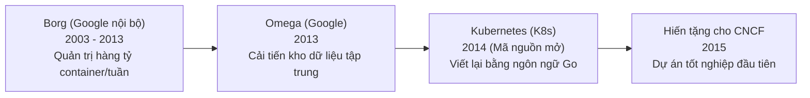

- **Borg (2003 - 2013):** Hệ thống bí mật được Google phát triển nội bộ để vận hành các siêu dịch vụ tìm kiếm Google Search, Gmail, YouTube và Google Maps. Borg xử lý hàng tỷ container mỗi tuần trên hàng trăm ngàn máy chủ vật lý.
- **Omega (2013):** Thế hệ thứ hai của Borg, tập trung tối ưu hóa kiến trúc kho dữ liệu trạng thái tập trung và các thuật toán lập lịch giao dịch đồng thời (Optimistic Concurrency Control).
- **Kubernetes ra đời (2014):** Các kỹ sư hàng đầu của Google (Joe Beda, Brendan Burns, Craig McLuckie cùng các cộng sự) đã tập hợp toàn bộ tri thức và bài học xương máu suốt hơn 10 năm từ Borg và Omega để tái thiết kế một hệ thống hoàn toàn mới từ đầu bằng ngôn ngữ lập trình **Go (Golang)** và công bố mã nguồn mở dưới tên gọi **Kubernetes** (tiếng Hy Lạp cổ có nghĩa là *Người hoa tiêu* hoặc *Thuyền trưởng lái tàu*).
- **CNCF (2015):** Google bắt tay với Quỹ Linux (Linux Foundation) thành lập **Cloud Native Computing Foundation (CNCF)** và chính thức hiến tặng Kubernetes như là dự án hạt nhân đầu tiên. Hiện nay, Kubernetes là dự án mã nguồn mở có sức ảnh hưởng và tốc độ phát triển lớn nhất trong toàn bộ lịch sử điện toán đám mây.

---

## 1.4. Triết lý cốt lõi: Khai báo trạng thái (Declarative) vs Thực thi mệnh lệnh (Imperative)

Sự khác biệt mang tính cách mạng giữa Kubernetes và các hệ thống quản trị máy chủ truyền thống nằm ở mô hình cấu hình:

| Tiêu chí | Mô hình Mệnh lệnh (Imperative Approach) | Mô hình Khai báo (Declarative Approach) - Triết lý K8s |
| :--- | :--- | :--- |
| **Bản chất** | Hướng dẫn hệ thống *phải làm từng bước như thế nào* (How to do). | Mô tả trạng thái *kết quả cuối cùng mong muốn là gì* (What to achieve). |
| **Ví dụ thực tế** | *"Chạy 3 container nginx, gán IP X, nếu chết thì gõ lệnh restart, mở port 80..."* | *"Tôi mong muốn trong hệ thống luôn có chính xác 3 bản sao nginx phiên bản 1.25 hoạt động."* |
| **Tính lũy đẳng (Idempotence)** | Kém. Chạy lại một đoạn kịch bản bash/shell script 2 lần có thể sinh ra lỗi tạo trùng lặp hoặc xung đột. | Hoàn hảo. Dù áp dụng khai báo 1 lần hay 100 lần, hệ thống luôn giữ nguyên trạng thái mong muốn. |
| **Xử lý sự cố** | Phụ thuộc vào người quản trị hoặc cronjob chạy lệnh can thiệp khi có lỗi. | Hệ thống tự động so khớp liên tục; nếu số lượng giảm xuống còn 2, K8s tự động bật thêm 1 bản sao. |
| **Định dạng thể hiện** | Các chuỗi câu lệnh CLI (`docker run`, `systemctl start`). | Các tệp cấu hình có cấu trúc chuẩn hóa (`YAML` hoặc `JSON`). |

---

## 1.5. Vòng lặp điều hòa trạng thái (Reconciliation Loop / Control Loop)

Mọi thành phần trong Kubernetes đều vận hành dựa trên một cơ chế nền tảng duy nhất: **Vòng lặp đối soát / điều hòa trạng thái (Reconciliation Loop)**:

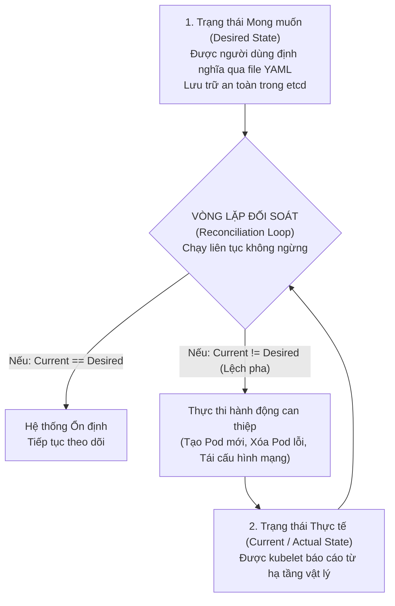

Vòng lặp này hoạt động theo 3 bước liên tục:
$$\text{Observe (Quan sát)} \longrightarrow \text{Diff (So sánh sai lệch)} \longrightarrow \text{Act (Hành động đưa về chuẩn)}$$

Chính nhờ cơ chế này, Kubernetes sở hữu khả năng **Tự phục hồi (Self-Healing)** thần kỳ. Nếu một container bị sập, một tiến trình bị lỗi bộ nhớ, hay thậm chí cả một chiếc máy chủ vật lý phát nổ, bộ điều khiển của Kubernetes sẽ ngay lập tức nhận diện trạng thái thực tế không còn khớp với trạng thái mong muốn trong file YAML, từ đó tự động lên lịch tạo một container thay thế tại một máy chủ khỏe mạnh khác mà không cần con người thức giấc can thiệp.

---

# PHẦN 2: KIẾN TRÚC TỔNG THỂ KUBERNETES (K8S ARCHITECTURE DEEP DIVE)

## 2.1. Sơ đồ kiến trúc phân tán Master - Worker

Một cụm Kubernetes (Cluster) bao gồm tối thiểu hai nhóm máy chủ:
1. **Control Plane (Node Quản trị / Master Node):** Bộ não trung tâm chỉ huy mọi quyết định trong toàn bộ cụm.
2. **Worker Nodes (Node Thực thi / Máy trạm):** Hạ tầng vật lý hoặc máy ảo trực tiếp gánh tải, nơi các ứng dụng nghiệp vụ được đóng gói dưới dạng container thực sự hoạt động.

```mermaid
flowchart TB
    subgraph ControlPlane["CONTROL PLANE (MASTER NODE) - BỘ NÃO ĐIỀU HÀNH"]
        direction TB
        API["kube-apiserver<br/>(Cổng giao tiếp duy nhất & RESTful Gateway)"]
        ETCD[("etcd<br/>(Distributed Key-Value Store)")]
        SCHED["kube-scheduler<br/>(Bộ phân bổ tài nguyên & lập lịch Pod)"]
        KCM["kube-controller-manager<br/>(Bộ điều phối trạng thái)"]
        CCM["cloud-controller-manager<br/>(Tích hợp AWS/GCP/Azure)"]
        
        API <--> ETCD
        API <--> SCHED
        API <--> KCM
        API <--> CCM
    end

    Admin["Quản trị viên / CI-CD Pipeline<br/>(Sử dụng công cụ kubectl)"] -->|gọi lệnh HTTPS:6443| API

    subgraph Worker1["WORKER NODE 1 (MÁY TRẠM THỰC THI)"]
        direction TB
        Kubelet1["kubelet<br/>(Đặc phái viên điều hành Node)"]
        Proxy1["kube-proxy<br/>(Bộ định tuyến iptables/IPVS)"]
        Runtime1["Container Runtime<br/>(containerd / CRI-O)"]
        
        subgraph Pods1["CÁC POD ĐANG CHẠY"]
            P1["Pod: Frontend<br/>(Web Server)"]
            P2["Pod: Backend API<br/>(NodeJS/Java)"]
        end
        
        Kubelet1 --> Runtime1
        Runtime1 --> P1
        Runtime1 --> P2
    end

    subgraph Worker2["WORKER NODE 2 (MÁY TRẠM THỰC THI)"]
        direction TB
        Kubelet2["kubelet"]
        Proxy2["kube-proxy"]
        Runtime2["Container Runtime"]
        
        subgraph Pods2["CÁC POD ĐANG CHẠY"]
            P3["Pod: Database<br/>(PostgreSQL)"]
            P4["Pod: Background Worker<br/>(Celery/RabbitMQ)"]
        end
        
        Kubelet2 --> Runtime2
        Runtime2 --> P3
        Runtime2 --> P4
    end

    API <==>|Chỉ thị PodSpec & Báo cáo nhịp tim (Heartbeat)| Kubelet1
    API <==>|Chỉ thị PodSpec & Báo cáo nhịp tim (Heartbeat)| Kubelet2
    API -.->|Cập nhật quy tắc Service/Endpoints| Proxy1
    API -.->|Cập nhật quy tắc Service/Endpoints| Proxy2
```

---

## 2.2. Các thành phần Control Plane (Master Node)

Control Plane là bộ não chỉ huy tối cao của cụm Kubernetes. Các tiến trình này chịu trách nhiệm đưa ra mọi quyết định mang tính toàn cục (như lập lịch cho Pod, phát hiện máy chủ chết, tự động co giãn).

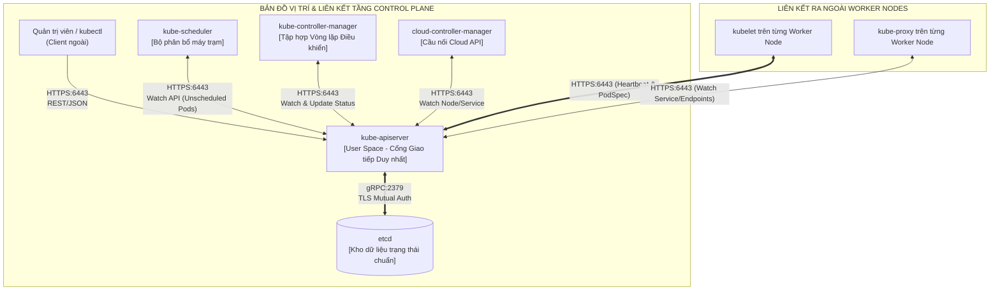

---

### 2.2.1. kube-apiserver: Trái tim và Cổng giao tiếp duy nhất

#### 📍 1. Vị trí trong Hệ thống (System Location & Runtime Space)
- **Máy chủ thực thi:** Chạy độc quyền trên các máy chủ **Control Plane (Master Node)**.
- **Hình thức triển khai:** Chạy dưới dạng **Static Pod** (được kubelet tự quản lý thông qua manifest tại `/etc/kubernetes/manifests/kube-apiserver.yaml`) hoặc tiến trình độc lập systemd.
- **Không gian bộ nhớ:** Chạy trong không gian người dùng (**User Space**).
- **Cổng kết nối mặc định (Default Ports & Protocol):**
  - `TCP 6443` (HTTPS mã hóa TLS): Cổng tiếp nhận toàn bộ các truy vấn từ client bên ngoài (`kubectl`), các worker agents (`kubelet`, `kube-proxy`), và các thành phần nội bộ.
  - Hỗ trợ mô hình Stateless hoàn toàn: Có thể đặt nhiều máy chủ API Server đứng sau một bộ cân bằng tải **Layer 4 Load Balancer** (như HAProxy/Keepalived/AWS NLB) để xây dựng cụm High Availability.

#### 🔗 2. Bản đồ Liên kết & Giao thức (Topology & Protocols)

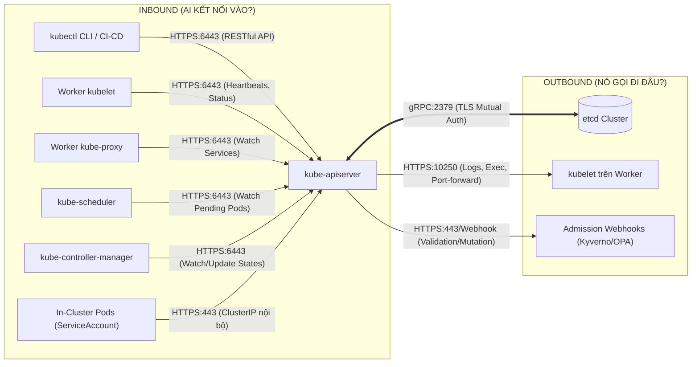

- **Quy tắc bất biến:** `kube-apiserver` là thành phần **DUY NHẤT** trong toàn cụm có quyền đọc và ghi dữ liệu trực tiếp vào `etcd`. Mọi thành phần khác muốn truy xuất etcd đều bắt buộc phải gửi yêu cầu thông qua API Server.

#### ⚙️ 3. Logic Hoạt động & Phối hợp (Operational Logic & Lifecycle)
1. **Tiếp nhận & Bóc tách:** Nhận gói tin HTTPS RESTful request chứa cấu hình tài nguyên (JSON/YAML).
2. **Xác thực (Authentication):** Kiểm tra chữ ký số X.509 Client Certificate, OpenID Connect Token, hoặc ServiceAccount Token.
3. **Ủy quyền (Authorization):** Tra cứu bảng quy tắc RBAC (Role-Based Access Control) để kiểm tra Client có quyền thực thi hành động (`get`, `create`, `delete`,...) trên tài nguyên đó không.
4. **Kiểm duyệt (Admission Control):**
   - Đưa qua chuỗi **Mutating Webhooks** để bổ sung hoặc chuẩn hóa cấu hình ngầm.
   - Kiểm tra tính hợp lệ của lược đồ dữ liệu (**Schema Validation**).
   - Đưa qua chuỗi **Validating Webhooks** để phê duyệt hoặc từ chối theo chính sách bảo mật của doanh nghiệp.
5. **Ghi nhận & Đồng bộ:** Chuyển đổi đối tượng sang định dạng nhị phân Protocol Buffers và ghi trực tiếp vào cơ sở dữ liệu `etcd`.
6. **Bắn thông báo (Watch Mechanism):** Duy trì các kết nối HTTP Long-polling / HTTP Streaming để đẩy ngay thông báo cập nhật về đối tượng vừa thay đổi tới các bên liên quan (`kube-scheduler`, `kubelet`, `kube-proxy`).

---

### 2.2.2. etcd: Kho dữ liệu phân tán Key-Value và Thuật toán Raft Consensus

#### 📍 1. Vị trí trong Hệ thống (System Location & Runtime Space)
- **Máy chủ thực thi:** Nằm trên các máy chủ **Control Plane** (chạy chung với Master Node hoặc cụm máy chủ etcd chuyên biệt độc lập).
- **Hình thức triển khai:** Static Pod (`/etc/kubernetes/manifests/etcd.yaml`) hoặc systemd service.
- **Không gian bộ nhớ:** User Space (viết bằng ngôn ngữ Go).
- **Cổng kết nối mặc định (Default Ports & Protocol):**
  - `TCP 2379`: Cổng phục vụ Client giao tiếp qua gRPC (chỉ mở cho `kube-apiserver`).
  - `TCP 2380`: Cổng trao đổi nội bộ giữa các thành phần etcd trong cụm (Peer-to-Peer Communication).

#### 🔗 2. Bản đồ Liên kết & Giao thức (Topology & Protocols)

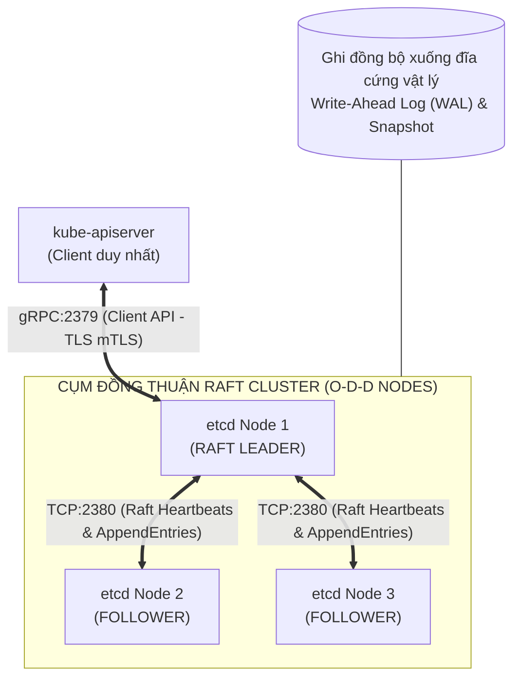

#### ⚙️ 3. Logic Hoạt động & Phối hợp (Operational Logic & Lifecycle)
1. **Lưu trữ toàn vẹn trạng thái:** etcd là "Nguồn chân lý" duy nhất của Kubernetes. Nếu mất toàn bộ etcd mà không có bản sao lưu (Backup), cụm Kubernetes coi như bị phá hủy hoàn toàn.
2. **Cơ chế Raft Consensus:**
   - Để ghi một dữ liệu mới: Leader nhận bản ghi từ API Server, ghi vào tệp nhật ký cục bộ (**Write-Ahead Log - WAL**), phát lệnh `AppendEntries` sang tất cả Follower qua cổng 2380.
   - Khi đa số thành viên (**Quorum**: $\lfloor N/2 \rfloor + 1$) xác nhận đã ghi log an toàn, Leader mới chính thức xác nhận lệnh ghi thành công (Commit) và trả lời về cho API Server.
3. **Cơ chế Watch:** etcd lưu lại lịch sử thay đổi của từng khóa thông qua số thứ tự phiên bản (`Revision`). API Server sử dụng tính năng Watch này để nhận diện tức thì mọi sự kiện thêm/sửa/xóa mà không cần tốn tài nguyên truy vấn vòng lặp (Polling).

---

### 2.2.3. kube-scheduler: Cơ chế đánh giá và phân bổ Pod

#### 📍 1. Vị trí trong Hệ thống (System Location & Runtime Space)
- **Máy chủ thực thi:** Chạy trên máy chủ **Control Plane**.
- **Hình thức triển khai:** Static Pod (`/etc/kubernetes/manifests/kube-scheduler.yaml`) hoặc systemd service.
- **Không gian bộ nhớ:** User Space.
- **Cổng kết nối mặc định:** `TCP 10259` (HTTPS kiểm tra sức khỏe và chỉ số metrics).

#### 🔗 2. Bản đồ Liên kết & Giao thức (Topology & Protocols)

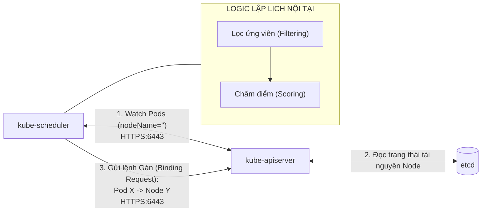

#### ⚙️ 3. Logic Hoạt động & Phối hợp (Operational Logic & Lifecycle)
1. **Theo dõi hàng đợi:** Scheduler duy trì một kết nối Watch với API Server, liên tục lắng nghe sự xuất hiện của các Pod có trường `spec.nodeName` còn để trống (trạng thái `Pending`).
2. **Giai đoạn Lọc (Filtering / Predicates):** Loại trừ các Worker Node không đủ năng lực (hết RAM/CPU, không khớp `nodeSelector`, bị vướng `Taints` mà Pod không có `Tolerations`).
3. **Giai đoạn Chấm điểm (Scoring / Priorities):** Với các Node còn lại, tính tổng điểm dựa trên thuật toán cân bằng tải (`LeastRequestedPriority`), phân tán địa lý (`PodTopologySpreadConstraints`), hoặc độ thân thuộc (`PodAffinity`).
4. **Thực thi Gán (Binding):** Node có số điểm cao nhất được lựa chọn. Scheduler tạo một đối tượng `Binding` gửi qua HTTPS về cho API Server để ghi nhận `nodeName` vào etcd. Kubelet tại Worker Node được chọn sẽ lập tức nhận lệnh khởi chạy Pod.

---

### 2.2.4. kube-controller-manager: Tập hợp các bộ điều khiển tự phục hồi

#### 📍 1. Vị trí trong Hệ thống (System Location & Runtime Space)
- **Máy chủ thực thi:** Chạy trên máy chủ **Control Plane**.
- **Hình thức triển khai:** Static Pod (`/etc/kubernetes/manifests/kube-controller-manager.yaml`) hoặc systemd service.
- **Không gian bộ nhớ:** User Space.
- **Cổng kết nối mặc định:** `TCP 10257` (HTTPS endpoint kiểm tra sức khỏe và metrics).

#### 🔗 2. Bản đồ Liên kết & Giao thức (Topology & Protocols)

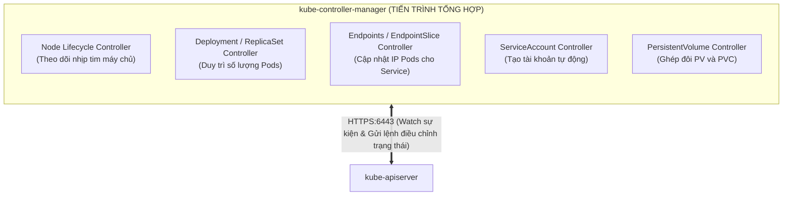

#### ⚙️ 3. Logic Hoạt động & Phối hợp (Operational Logic & Lifecycle)
`kube-controller-manager` hiện thực hóa triết lý **Vòng lặp điều hòa (Reconciliation Loop)**:
1. **Quan sát liên tục (Observe):** Mỗi bộ điều khiển con bên trong tiến trình độc lập theo dõi một loại tài nguyên cụ thể thông qua API Server.
2. **Phát hiện sai lệch (Diff):** So sánh giữa **Desired State** (Trạng thái khai báo trong YAML) và **Actual State** (Trạng thái thực tế trên cụm).
3. **Can thiệp khắc phục (Act):**
   - *Ví dụ 1 (Deployment Controller):* Khi người dùng scale replicas từ 3 lên 5, Controller nhận diện thiếu 2 Pod $\rightarrow$ Gửi chỉ thị yêu cầu API Server tạo thêm 2 Pod mới.
   - *Ví dụ 2 (Node Controller):* Nếu Worker Node 2 không gửi nhịp tim trong 40 giây $\rightarrow$ Đổi trạng thái Node thành `NotReady`. Nếu mất liên lạc quá 5 phút $\rightarrow$ Ra lệnh trục xuất toàn bộ Pod sang Node khác.
   - *Ví dụ 3 (Endpoints Controller):* Khi một Pod mới khởi động thành công và vượt qua Readiness Probe $\rightarrow$ Lập tức thêm IP của Pod vào danh sách `Endpoints` của Service tương ứng.

---

### 2.2.5. cloud-controller-manager: Cầu nối hạ tầng điện toán đám mây

#### 📍 1. Vị trí trong Hệ thống (System Location & Runtime Space)
- **Máy chủ thực thi:** Control Plane trên các cụm triển khai trên Cloud (AWS EKS, Google Cloud GKE, Azure AKS, OpenStack).
- **Không gian bộ nhớ:** User Space.

#### 🔗 2. Bản đồ Liên kết & Giao thức (Topology & Protocols)

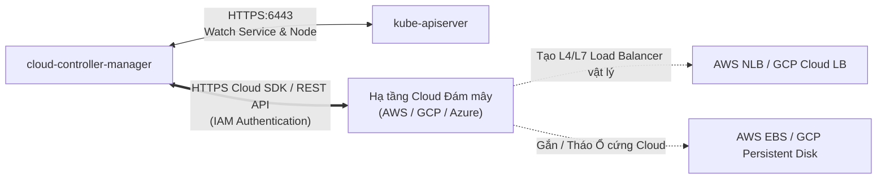

#### ⚙️ 3. Logic Hoạt động & Phối hợp (Operational Logic & Lifecycle)
- **Node Controller:** Giao tiếp với Cloud API để kiểm tra xem một máy ảo Worker Node đã thực sự bị xóa sổ trên hạ tầng Cloud chưa để kịp thời giải phóng tài nguyên K8s.
- **Service Controller:** Khi người dùng khai báo `Service type: LoadBalancer`, thành phần này lập tức gọi API của Cloud để tự động khởi tạo bộ cân bằng tải vật lý bên ngoài (như AWS Network Load Balancer), lấy địa chỉ IP công khai trả ngược về ghi vào trường `status.loadBalancer.ingress` của Service.
- **Route Controller:** Thiết lập bảng định tuyến mạng VPC nội bộ của Cloud để các gói tin di chuyển giữa các Worker Node thông suốt.

---

## 2.3. Các thành phần Worker Node

Worker Node là nơi trực tiếp tiêu thụ tài nguyên phần cứng (CPU, RAM, Ổ cứng, Băng thông mạng) để chạy các vùng chứa ứng dụng thực tế.

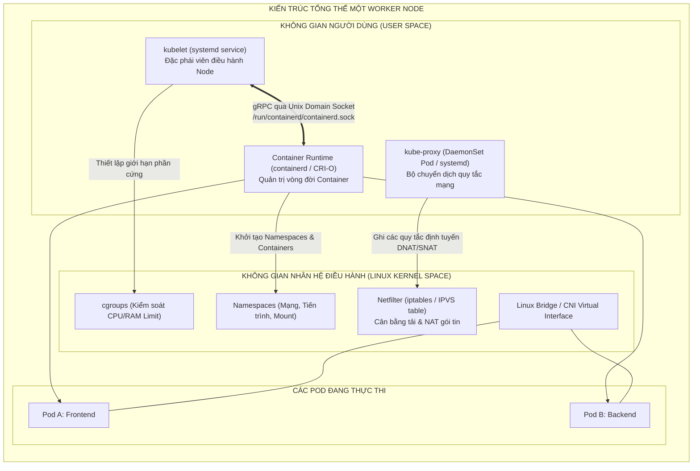

---

### 2.3.1. kubelet: Đặc phái viên thực thi trên máy trạm

#### 📍 1. Vị trí trong Hệ thống (System Location & Runtime Space)
- **Máy chủ thực thi:** Chạy trên **TẤT CẢ các Worker Node** (và cả Master Node).
- **Hình thức triển khai:** Chạy trực tiếp dưới dạng **systemd service** của hệ điều hành Linux (không thể chạy dưới dạng Container thông thường vì nó cần quyền điều khiển trực tiếp hệ điều hành máy chủ).
- **Không gian bộ nhớ:** User Space (với đặc quyền quản trị `root`).
- **Cổng kết nối mặc định (Default Ports & Protocol):**
  - `TCP 10250` (Kubelet HTTPS API): Tiếp nhận lệnh tương tác trực tiếp từ `kube-apiserver`.
  - `TCP 10248` (Healthz Endpoint): Báo cáo trạng thái sống của chính kubelet cho hệ điều hành.

#### 🔗 2. Bản đồ Liên kết & Giao thức (Topology & Protocols)

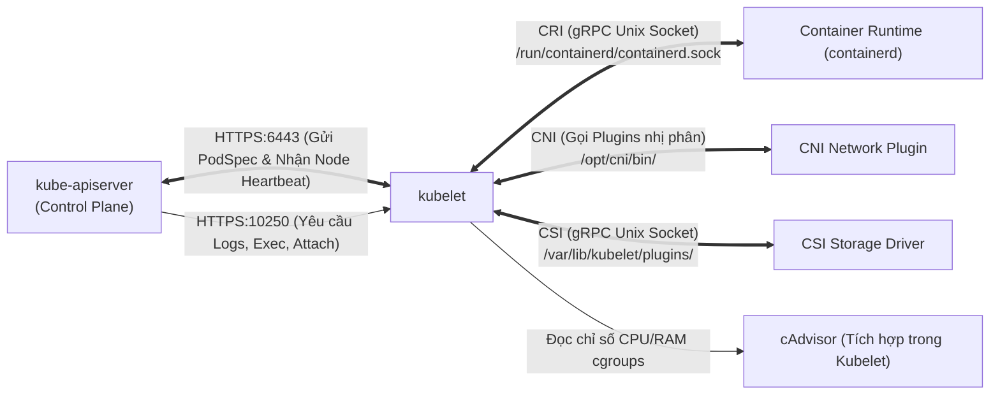

#### ⚙️ 3. Logic Hoạt động & Phối hợp (Operational Logic & Lifecycle)
1. **Lắng nghe nhiệm vụ:** Kubelet liên tục mở kết nối HTTPS Watch tới API Server để đón nhận danh sách các Pod được gán cho chính nó (`spec.nodeName == MyNodeName`).
2. **Kích hoạt Runtime (Chuẩn CRI):** Khi có Pod mới, kubelet gọi qua giao diện gRPC Unix Domain Socket tới Container Runtime (containerd) yêu cầu:
   - Tạo vùng chứa đệm **Pause Container** giữ Network Namespace.
   - Kéo các Docker Image cần thiết về máy.
   - Khởi chạy các container ứng dụng.
3. **Gọi CNI & CSI:** Kubelet gọi plugin mạng CNI để cấp phát IP, tạo cặp cáp mạng ảo `veth`, và gọi CSI driver để mount thư mục ổ cứng lưu trữ vào đúng vị trí trên máy chủ.
4. **Kiểm tra sức khỏe (Health Probes):** Kubelet trực tiếp thực hiện các bài kiểm tra **StartupProbe**, **LivenessProbe** và **ReadinessProbe** theo định kỳ. Nếu container chết hoặc LivenessProbe thất bại, kubelet ra lệnh cho Runtime restart container.
5. **Báo cáo định kỳ (Heartbeat):** Mỗi 10 giây (mặc định), Kubelet gửi thông điệp nhịp tim `NodeStatus` (dung lượng CPU/RAM khả dụng, trạng thái ổ đĩa) về API Server thông qua đối tượng `Lease`.

---

### 2.3.2. kube-proxy: Bộ định tuyến mạng và quản lý Service IP

#### 📍 1. Vị trí trong Hệ thống (System Location & Runtime Space)
- **Máy chủ thực thi:** Chạy trên **tất cả các Worker Node** trong cụm.
- **Hình thức triển khai:** Triển khai dưới dạng một **DaemonSet** (Pod mang tên `kube-proxy-xxx` trong namespace `kube-system`).
- **Không gian bộ nhớ:** Bản thân kube-proxy chạy trong **User Space**, nhưng nó can thiệp trực tiếp vào cấu trúc bảng của **Kernel Space (Linux Netfilter/iptables hoặc IPVS)**.
- **Cổng kết nối mặc định:** `TCP 10256` (Health check endpoint phục vụ các bộ cân bằng tải bên ngoài).

#### 🔗 2. Bản đồ Liên kết & Giao thức (Topology & Protocols)

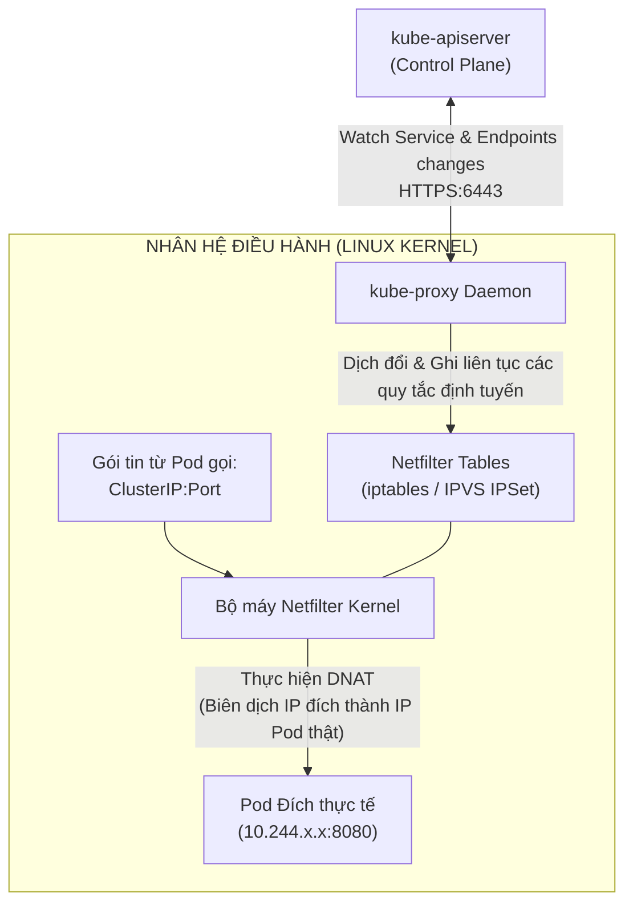

#### ⚙️ 3. Logic Hoạt động & Phối hợp (Operational Logic & Lifecycle)
1. **Lắng nghe thay đổi:** kube-proxy theo dõi các sự kiện thêm/xóa/sửa của các đối tượng `Service` và `EndpointSlice` từ API Server.
2. **Cập nhật Kernel Netfilter:**
   - Khi một Service mới mang IP `10.96.0.10:80` đại diện cho 3 Pod (`10.244.1.2`, `10.244.2.5`, `10.244.3.8`) được tạo ra:
   - kube-proxy không đứng ra trung chuyển gói tin (tránh nghẽn cổ chai). Thay vào đó, nó ghi trực tiếp các quy tắc chuyển đổi địa chỉ mạng đích (**DNAT - Destination NAT**) vào bảng luật `iptables` hoặc `IPVS` của nhân Linux trên chính máy chủ đó.
3. **Cân bằng tải cấp gói tin:** Khi một tiến trình gửi gói tin tới `10.96.0.10:80`, tầng mạng của nhân Linux bắt gói tin này, áp dụng thuật toán xác suất ngẫu nhiên và biến đổi địa chỉ đích thành IP của một trong các Pod khỏe mạnh tức thì với độ trễ tính bằng micro-giây.

---

### 2.3.3. Container Runtime & Chuẩn giao tiếp CRI (containerd, CRI-O)

#### 📍 1. Vị trí trong Hệ thống (System Location & Runtime Space)
- **Máy chủ thực thi:** Cài đặt trực tiếp trên toàn bộ các Worker Node.
- **Hình thức triển khai:** Chạy dưới dạng tiến trình nền daemon hệ điều hành (**systemd service** mang tên `containerd.service` hoặc `crio.service`).
- **Không gian bộ nhớ:** User Space.
- **Điểm giao tiếp (Socket Endpoint):** Giao tiếp hoàn toàn nội bộ thông qua **Unix Domain Socket** (ví dụ: `unix:///run/containerd/containerd.sock`), không mở cổng mạng ra bên ngoài nhằm đảm bảo an toàn tuyệt đối.

#### 🔗 2. Bản đồ Liên kết & Giao thức (Topology & Protocols)

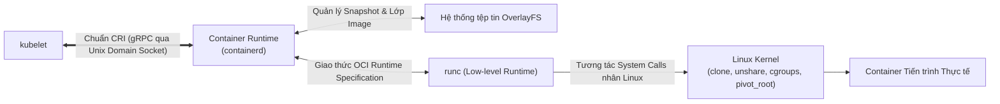

#### ⚙️ 3. Logic Hoạt động & Phối hợp (Operational Logic & Lifecycle)
1. **Tiếp nhận lệnh CRI:** Nhận các chỉ thị trừu tượng từ Kubelet thông qua gRPC: `RunPodSandbox()`, `CreateContainer()`, `StartContainer()`, `StopContainer()`.
2. **Quản lý Image:** Tải Docker Image từ kho lưu trữ (Docker Hub, Harbor, AWS ECR), bóc tách các lớp Layer và gắn kết qua hệ thống tệp tin **OverlayFS**.
3. **Ủy quyền cho Low-level Runtime (runc):** containerd không trực tiếp tạo tiến trình. Nó sinh ra một cấu hình đặc tả `config.json` theo chuẩn **OCI (Open Container Initiative)** và gọi **runc**.
4. **Kích hoạt nhân Linux:** `runc` thực thi các cuộc gọi hệ thống (`unshare`, `clone`) để tạo các bức tường ngăn cách **Namespaces** và áp đặt trần định mức phần cứng **cgroups** trước khi biến mã nhị phân của ứng dụng thành một tiến trình sống.

---

## 2.4. Các Add-on thiết yếu trong Cụm

Add-on là các Pod chuyên biệt chạy trực tiếp bên trong cụm (thường nằm ở namespace `kube-system`), cung cấp các tính năng hạ tầng sống còn mà nếu thiếu chúng, cụm Kubernetes không thể vận hành được các dịch vụ thực tế.

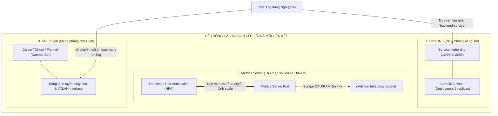

### 2.4.1. CoreDNS: Hệ thống phân giải tên miền nội bộ
- **Vị trí & Hình thức:** Chạy dưới dạng một Deployment (mặc định 2 replicas) trong namespace `kube-system`, đứng sau một Service cố định tên là `kube-dns` mang địa chỉ IP tĩnh (thường là IP thứ 10 của dải mạng Service, ví dụ: `10.96.0.10:53`).
- **Liên kết & Giao thức:** Lắng nghe trên cổng `UDP/TCP 53`. Mỗi Pod khi được tạo ra đều được kubelet tự động cấu hình tệp `/etc/resolv.conf` trỏ máy chủ nameserver về địa chỉ `10.96.0.10`.
- **Logic vận hành:** CoreDNS liên tục mở Watch API tới `kube-apiserver`. Khi có một Service mới được tạo, CoreDNS tự động sinh bản ghi DNS dạng:
  $$\text{<service-name>}.\text{<namespace>}.\text{svc.cluster.local}$$
  Nhờ đó, mã nguồn ứng dụng chỉ cần gọi tên dịch vụ mà không cần quan tâm đến địa chỉ IP vật lý.

### 2.4.2. Metrics Server: Cung cấp chỉ số hiệu năng phục vụ Autoscaling
- **Vị trí & Hình thức:** Chạy dưới dạng một Deployment đơn lẻ trong `kube-system`.
- **Liên kết:** Kết nối trực tiếp tới cổng `HTTPS 10250` của kubelet trên toàn bộ các Worker Node để thu thập dữ liệu bộ đệm hiệu năng từ module **cAdvisor**.
- **Logic vận hành:** Metrics Server lưu trữ số liệu tức thời trong bộ nhớ RAM (không ghi vào đĩa) và phơi bày dữ liệu thông qua chuẩn **Kubernetes Metrics API** (`/apis/metrics.k8s.io/v1beta1`). Đây là nguồn dữ liệu duy nhất kích hoạt cơ chế tự động mở rộng theo chiều ngang **Horizontal Pod Autoscaler (HPA)** và câu lệnh giám sát nhanh `kubectl top`.

### 2.4.3. CNI Plugin: Hạ tầng mạng phẳng liên kết các máy chủ
- **Vị trí & Hình thức:** Chạy dưới dạng một **DaemonSet** trên toàn bộ các Node, đồng thời cài đặt các tệp tin cấu hình vào `/etc/cni/net.d/` và các file thực thi nhị phân vào `/opt/cni/bin/`.
- **Logic vận hành:** Khi Kubelet nhận lệnh khởi tạo Pod, nó gọi trực tiếp tệp nhị phân CNI. CNI chịu trách nhiệm: Cấp phát một địa chỉ IP duy nhất từ dải IP dành riêng cho Node đó (IPAM), tạo cặp card mạng ảo `veth`, cắm một đầu vào Pod, đầu kia vào bridge máy chủ, và thiết lập đường hầm đóng gói gói tin (**VXLAN Tunnel**) hoặc nạp bảng định tuyến BGP để các Pod liên lạc với nhau thông suốt trên toàn bộ mạng trung tâm dữ liệu.

---

## 2.5. Sơ đồ chuỗi toàn diện: Vòng đời khởi tạo một Pod từ A-Z qua toàn bộ các thành phần

Để hiểu rõ sự phối hợp nhịp nhàng và logic liên kết giữa tất cả các thành phần trong hệ thống, hãy quan sát chuỗi hành động diễn ra từ thời điểm người quản trị gõ lệnh triển khai cho đến khi một Pod thực sự đón nhận lưu lượng truy cập:

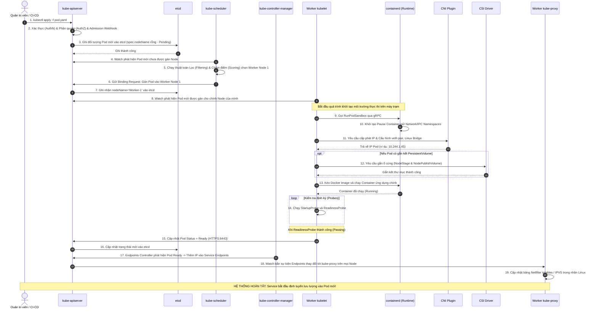

---

# PHẦN 3: CÁC ĐỐI TƯỢNG VÀ TÀI NGUYÊN TÍNH TOÁN CỐT LÕI (CORE WORKLOADS)

Tầng Workloads đại diện cho các ứng dụng thực thi mà người dùng triển khai trên Kubernetes. Các đối tượng này được thiết kế theo mô hình **hướng đối tượng phân tầng (Hierarchical Abstraction)**: từ đơn vị nhỏ nhất là Pod cho đến các bộ điều khiển thông minh tự động hóa vòng đời ứng dụng.

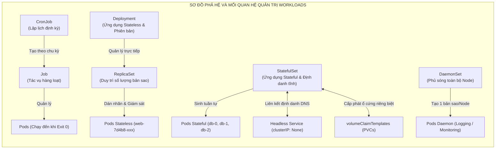

---

## 3.1. Pod: Nguyên tử cơ bản của Kubernetes

### 3.1.1. Bản chất của Pod và lý do K8s không chạy trực tiếp Container đơn lẻ

#### 📍 1. Vị trí trong Hệ thống (System Location & Runtime Space)
- **Máy chủ thực thi:** Được phân bổ nằm trên một **Worker Node** cụ thể do `kube-scheduler` quyết định.
- **Không gian thực thi:** Hoạt động tại tầng ranh giới giữa **User Space** (tiến trình ứng dụng) và **Kernel Space** (các tính năng cách ly Linux Namespaces & cgroups).
- **Định danh mạng:** Mỗi Pod được CNI cấp duy nhất **một địa chỉ IP thực** trong dải mạng nội bộ cụm (Pod CIDR).

#### 🔗 2. Bản đồ Liên kết & Giao thức (Topology & Protocols)

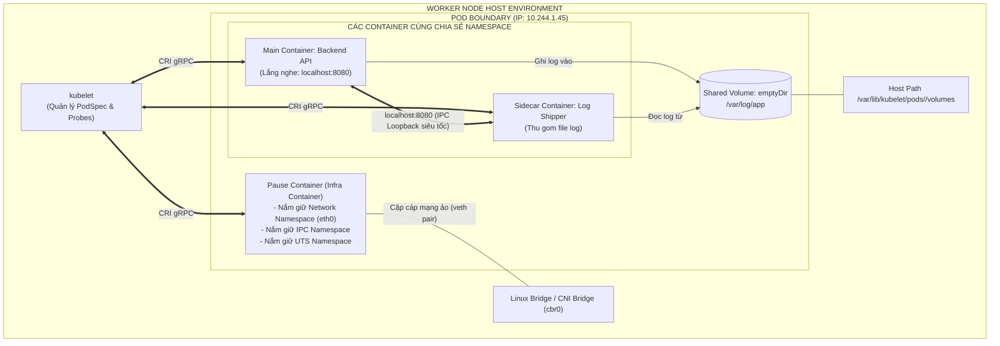

- **Inbound:** Tiếp nhận lưu lượng từ các Pod khác hoặc từ kube-proxy/Ingress thông qua giao diện mạng `eth0` do Pause Container nắm giữ.
- **Outbound:** Gửi truy vấn ra cơ sở dữ liệu hoặc ra ngoài Internet thông qua card mạng ảo `veth` nối với Bridge của máy chủ.

#### ⚙️ 3. Logic Hoạt động & Phối hợp (Operational Logic & Lifecycle)
1. **Vai trò cốt lõi của Pause Container:** Khi Pod khởi tạo, `containerd` chạy một container nền siêu nhẹ tên là `pause` (khoảng 700KB). Container này thực thi lệnh gọi hệ thống Linux `pause()` để giữ chỗ cho 3 Namespaces: **Network, IPC và UTS**.
2. **Cơ chế gia nhập:** Tất cả các container ứng dụng định nghĩa trong Pod sau đó được khởi chạy với cờ `--net=container:pause` và `--ipc=container:pause`. Nhờ đó:
   - Các container trong cùng Pod nhìn thấy chung một card mạng `eth0` và dùng chung địa chỉ IP.
   - Chúng có thể giao tiếp với nhau trực tiếp qua `localhost:<PORT>` với độ trễ gần bằng không.
   - Chúng có thể dùng cơ chế chia sẻ bộ nhớ Linux IPC Shared Memory để trao đổi dữ liệu tốc độ cao.
3. **Mối quan hệ với cgroups:** Giới hạn RAM/CPU khai báo trong Pod được áp đặt lên từng container riêng lẻ thông qua cây thư mục cgroups của Linux (`/sys/fs/cgroup/cpu,memory/kubepods/...`).

---

### 3.1.2. Mô hình Multi-Container: Sidecar, Init Container, Adapter và Ambassador

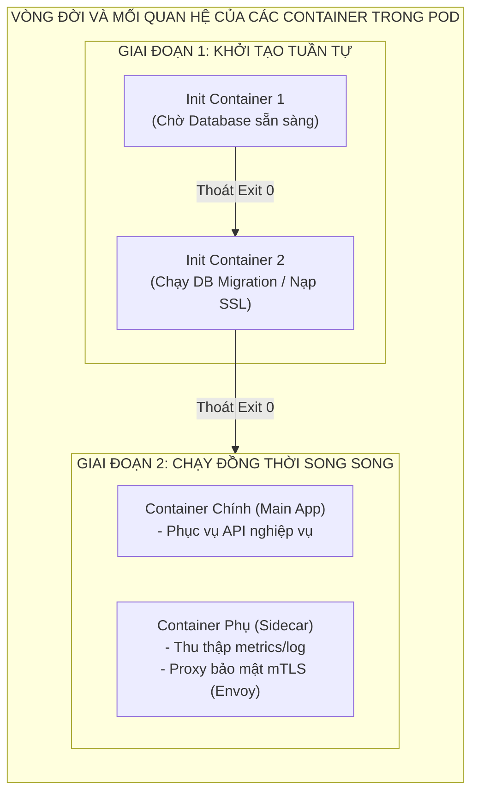

1. **Init Containers:**
   - Chạy và **hoàn thành tuần tự trước khi** bất kỳ container chính nào được phép khởi động.
   - Nếu bất kỳ Init Container nào thất bại (Exit code khác 0), Kubelet sẽ liên tục khởi động lại Pod đó theo `restartPolicy` cho đến khi thành công.
2. **Sidecar Container Pattern:**
   - Chạy song song và có vòng đời gắn chặt với container chính.
   - Kể từ Kubernetes v1.28+, tính năng **Native Sidecar** được kích hoạt chính thức: Khai báo Sidecar trong mảng `initContainers` kèm theo thuộc tính `restartPolicy: Always`. Kubelet sẽ khởi động Sidecar này lên trước, chờ nó Ready rồi mới khởi chạy container chính; và khi tắt Pod, container chính sẽ tắt trước rồi Sidecar mới tắt sau.

---

### 3.1.3. Cơ chế kiểm tra sức khỏe: Startup, Liveness và Readiness Probes

Kubelet chạy độc lập trên Worker Node và liên tục thăm dò trạng thái của ứng dụng theo chu kỳ:

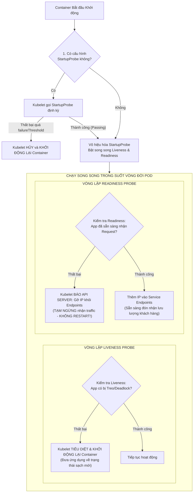

---

### 3.1.4. Quản lý tài nguyên: Request, Limit và các lớp QoS (Guaranteed, Burstable, BestEffort)

```text
┌─────────────────┬───────────────────────────────────────────┬────────────────────────────────────────┐
│ Lớp QoS         │ Điều kiện Thiết lập (CPU & Memory)        │ Hành vi Hệ thống khi Máy chủ cạn RAM   │
├─────────────────┼───────────────────────────────────────────┼────────────────────────────────────────┤
│ 1. Guaranteed   │ Requests == Limits (Áp dụng cho mọi       │ Mức ưu tiên cao nhất. Là đối tượng     │
│    (Đảm bảo)    │ container trong Pod).                     │ CUỐI CÙNG bị Kernel OOM-Killer hủy diệt│
├─────────────────┼───────────────────────────────────────────┼────────────────────────────────────────┤
│ 2. Burstable    │ Requests < Limits (Có khai báo nhưng      │ Mức ưu tiên trung bình. Bị trục xuất   │
│    (Co giãn)    │ không bằng nhau).                         │ khi tiêu thụ vượt quá mức cam kết      │
│                 │                                           │ (Requests) mà Node bị quá tải.         │
├─────────────────┼───────────────────────────────────────────┼────────────────────────────────────────┤
│ 3. BestEffort   │ Hoàn toàn KHÔNG khai báo bất kỳ thông số  │ Mức ưu tiên thấp nhất. Là đối tượng    │
│    (Tùy duyên)  │ Requests hoặc Limits nào.                 │ ĐẦU TIÊN bị K8s trục xuất và tiêu diệt!│
└─────────────────┴───────────────────────────────────────────┴────────────────────────────────────────┘
```

---

## 3.2. ReplicaSet: Đảm bảo số lượng bản sao mong muốn

#### 📍 1. Vị trí trong Hệ thống (System Location & Runtime Space)
- **Vị trí logic:** Bộ điều khiển ReplicaSet Controller chạy bên trong tiến trình **`kube-controller-manager`** tại Control Plane.
- **Tài nguyên lưu trữ:** Metadata được lưu trữ trong `etcd` dưới loại tài nguyên `replicasets.apps`.

#### 🔗 2. Bản đồ Liên kết & Giao thức (Topology & Protocols)

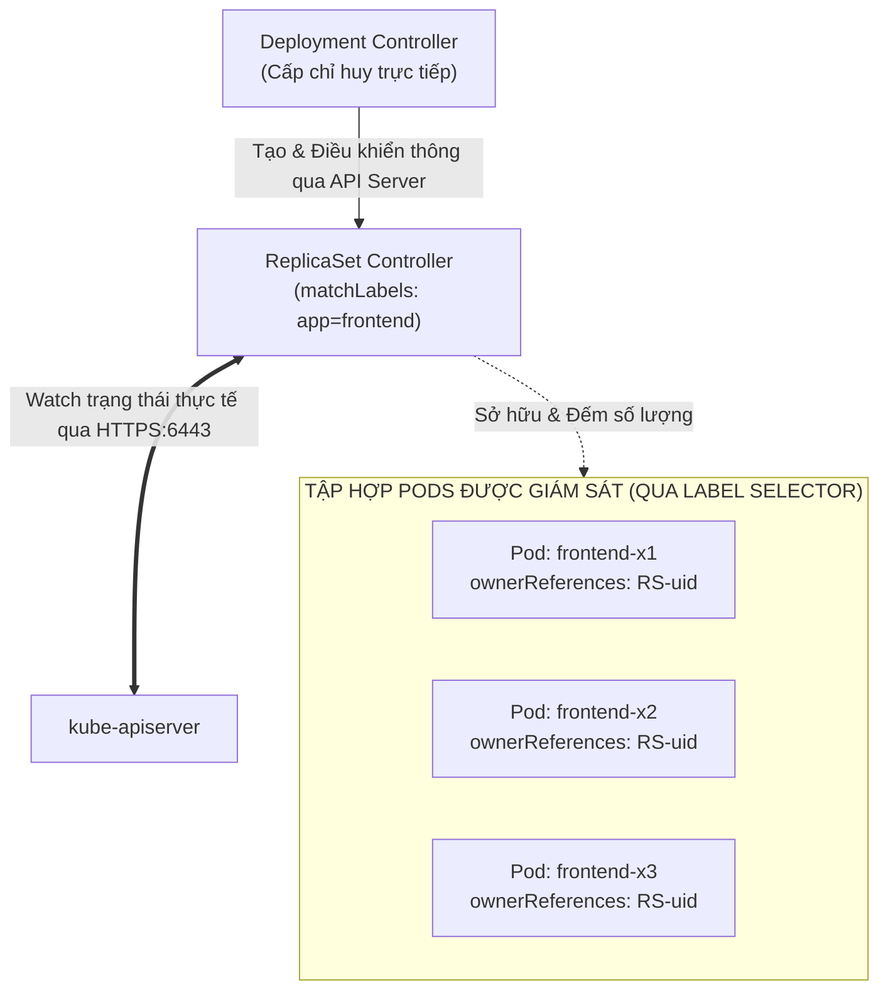

#### ⚙️ 3. Logic Hoạt động & Phối hợp (Operational Logic & Lifecycle)
- **Cơ chế liên kết OwnerReferences:** Khi ReplicaSet sinh ra một Pod mới, nó tự động gắn thuộc tính `metadata.ownerReferences` trỏ ngược về UID của chính ReplicaSet đó.
- **Vòng lặp đối soát (Reconciliation):**
  - Scheduler/Kubelet báo cáo số Pod mang nhãn `app=frontend` đang sống.
  - Nếu `Số lượng thực tế < spec.replicas`: Gửi yêu cầu API tạo thêm Pod.
  - Nếu `Số lượng thực tế > spec.replicas` (do người dùng tạo Pod thủ công cùng nhãn): Lựa chọn tiêu diệt bớt các Pod thừa, ưu tiên xóa Pod đang Pending hoặc Pod mới nhất.

---

## 3.3. Deployment: Quản trị phiên bản và chiến lược nâng cấp ứng dụng

#### 📍 1. Vị trí trong Hệ thống (System Location & Runtime Space)
- **Vị trí logic:** Deployment Controller chạy bên trong tiến trình **`kube-controller-manager`** tại Control Plane.

#### 🔗 2. Bản đồ Liên kết & Giao thức (Topology & Protocols)

```mermaid
flowchart TD
    AdminUser["Quản trị viên / CI Pipeline"] -->|"kubectl apply -f dep.yaml (v2)"| APIServer["kube-apiserver"]
    APIServer --> DepCtrl["Deployment Controller<br/>(kube-controller-manager)"]
    
    subgraph RSManagement["ĐIỀU KHIỂN CÁC REPLICASET THÀNH VIÊN"]
        DepCtrl -->|"Scale Down dần về 0"| RSOld["ReplicaSet Cũ (v1)<br/>Hash: 6d84f858"]
        DepCtrl -->|"Scale Up dần lên 3"| RSNew["ReplicaSet Mới (v2)<br/>Hash: 7b9c6f24"]
    end
    
    RSOld --> PodOld["Pods Cũ (Đang tắt dần)"]
    RSNew --> PodNew["Pods Mới (Đang bật dần)"]
```

#### ⚙️ 3. Logic Hoạt động: Quy trình Cập nhật Cuốn chiếu (RollingUpdate Step-by-Step)

Giả sử ứng dụng có `replicas: 3`, cấu hình cập nhật an toàn là `maxSurge: 1` và `maxUnavailable: 0`:

```mermaid
sequenceDiagram
    autonumber
    participant D as Deployment Controller
    participant RS1 as ReplicaSet v1 (Cũ)
    participant RS2 as ReplicaSet v2 (Mới)
    participant K as Kubelet & Pods

    Note over D: Người dùng thay đổi image từ v1 sang v2
    D->>RS2: 1. Tạo ReplicaSet v2 mới với replicas = 0
    D->>RS2: 2. Cho phép maxSurge = 1 -> Tăng replicas RS2 lên 1
    RS2->>K: 3. Khởi tạo Pod v2 đầu tiên
    K->>K: 4. Chạy StartupProbe & ReadinessProbe cho Pod v2
    Note over K: Pod v2 vượt qua bài kiểm tra -> Trạng thái: READY
    D->>RS1: 5. Vì maxUnavailable = 0 và đã có 1 Pod v2 Ready -> Giảm replicas RS1 từ 3 xuống 2
    RS1->>K: 6. Gửi tín hiệu SIGTERM tắt 1 Pod v1 cũ an toàn
    D->>RS2: 7. Tăng replicas RS2 lên 2 -> Chờ Pod v2 thứ hai Ready
    D->>RS1: 8. Giảm replicas RS1 từ 2 xuống 1
    D->>RS2: 9. Tăng replicas RS2 lên 3 -> Chờ Pod v2 thứ ba Ready
    D->>RS1: 10. Giảm replicas RS1 về 0 -> Toàn bộ Pod v1 đã được thay thế sạch sẽ!
    Note over D,RS2: NÂNG CẤP HOÀN TẤT VỚI 100% THỜI GIAN KHÔNG GIÁN ĐOẠN (ZERO-DOWNTIME)!
```

---

## 3.4. StatefulSet: Dành riêng cho ứng dụng có trạng thái (Stateful Workloads)

#### 📍 1. Vị trí trong Hệ thống (System Location & Runtime Space)
- **Vị trí logic:** StatefulSet Controller chạy bên trong **`kube-controller-manager`**.

#### 🔗 2. Bản đồ Liên kết Đa chiều (Multi-Component Integration Topology)

```mermaid
flowchart TD
    subgraph StatefulSetCluster["KIẾN TRÚC TÍCH HỢP TOÀN DIỆN CỦA STATEFULSET"]
        direction TB
        
        SSCtrl["StatefulSet Controller<br/>(Quản lý tuần tự)"]
        
        subgraph CoreDNSIntegration["TÍCH HỢP TÊN MIỀN NỘI BỘ (COREDNS)"]
            Headless["Headless Service<br/>(clusterIP: None)"]
            DNS1["web-0.my-svc.ns.svc.cluster.local"]
            DNS2["web-1.my-svc.ns.svc.cluster.local"]
            Headless --- DNS1
            Headless --- DNS2
        end

        subgraph PodsInstances["CÁC POD VỚI ĐỊNH DANH BẤT BIẾN"]
            Pod0["Pod: web-0<br/>(Chỉ số: 0 - Primary)"]
            Pod1["Pod: web-1<br/>(Chỉ số: 1 - Secondary)"]
        end

        subgraph StorageSubsystem["HẠ TẦNG LƯU TRỮ ĐỘC LẬP (CSI)"]
            PVC0["PVC: data-web-0"] <==> PV0[("PersistentVolume 0<br/>AWS EBS 50Gi")]
            PVC1["PVC: data-web-1"] <==> PV1[("PersistentVolume 1<br/>AWS EBS 50Gi")]
        end

        SSCtrl --> Pod0
        SSCtrl --> Pod1
        Pod0 -.->|"Đăng ký DNS"| DNS1
        Pod1 -.->|"Đăng ký DNS"| DNS2
        Pod0 ===|"Mount độc quyền"| PVC0
        Pod1 ===|"Mount độc quyền"| PVC1
    end
```

#### ⚙️ 3. Logic Hoạt động & Phối hợp (Operational Logic & Lifecycle)
1. **Tuân thủ quy tắc thứ tự khắt khe (`OrderedReady`):**
   - Pod `web-0` được khởi tạo trước. Kubernetes đợi cho đến khi `web-0` chuyển sang trạng thái `Running` và **vượt qua bài kiểm tra ReadinessProbe**, thì mới bắt đầu khởi tạo tiếp Pod `web-1`.
   - Khi scale down hoặc xóa StatefulSet, thứ tự bị đảo ngược hoàn toàn: Pod có chỉ số cao nhất sẽ bị tắt trước ($N-1 \rightarrow N-2 \dots \rightarrow 0$) để bảo đảm cụm database không bị mất quorum.
2. **Cơ chế gắn kết ổ đĩa bất biến:** Khác với Deployment (nơi ổ cứng có thể bị chia sẻ hoặc ngắt kết nối bừa bãi), mỗi PVC trong StatefulSet được đặt tên theo quy tắc cố định:
   $$\text{<volumeClaimTemplate-name>}-\text{<pod-name>}$$
   Khi một Worker Node gặp sự cố phần cứng và Pod `web-1` được hồi sinh trên một Worker Node hoàn toàn khác, StatefulSet Controller sẽ ra lệnh cho CSI Driver tháo ổ đĩa vật lý của `data-web-1` khỏi Node cũ và gắn chính xác vào Node mới cho Pod `web-1`. Dữ liệu trạng thái của phân vùng không bao giờ bị thất lạc.

---

## 3.5. DaemonSet: Đảm bảo phủ sóng toàn bộ máy trạm

#### 📍 1. Vị trí trong Hệ thống (System Location & Runtime Space)
- **Vị trí logic:** DaemonSet Controller chạy bên trong **`kube-controller-manager`**.

#### 🔗 2. Bản đồ Liên kết & Giao thức (Topology & Protocols)

```mermaid
flowchart TD
    API["kube-apiserver"] <-->|"Watch sự kiện Node Thêm/Bớt"| DSCtrl["DaemonSet Controller"]
    
    subgraph NodesPool["CỤM MÁY CHỦ WORKER"]
        direction LR
        subgraph N1["Worker Node 1"]
            P1["Pod: Fluentbit-ds"]
        end
        subgraph N2["Worker Node 2"]
            P2["Pod: Fluentbit-ds"]
        end
        subgraph N3["Worker Node 3 (Mới thêm vào)"]
            P3["Pod: Fluentbit-ds (Tự động tạo)"]
        end
    end

    DSCtrl -->|"1. Quét nhãn Node"| N1
    DSCtrl -->|"1. Quét nhãn Node"| N2
    DSCtrl -->|"2. Phát hiện Node 3 mới -> Lập tức tạo Pod"| N3
```

#### ⚙️ 3. Logic Hoạt động & Phối hợp (Operational Logic & Lifecycle)
- **Tự động hòa mạng:** Khi một kỹ sư hạ tầng bổ sung thêm một máy chủ vật lý mới vào cụm, DaemonSet Controller nhận được thông báo sự kiện từ API Server và ngay lập tức tạo một Pod tương ứng gán vào node mới đó mà không cần can thiệp thủ công.
- **Bypass Taints mặc định:** DaemonSet Controller tự động gắn thêm các `Tolerations` ngầm (như `node.kubernetes.io/not-ready`, `node.kubernetes.io/unreachable`) để đảm bảo các tiến trình hạ tầng quan trọng như CNI Network Agent hay Storage Driver có thể hoạt động ngay từ giai đoạn máy chủ đang khởi động.

---

## 3.6. Job và CronJob: Điều phối tác vụ hàng loạt và định kỳ

#### 📍 1. Vị trí trong Hệ thống (System Location & Runtime Space)
- **Vị trí logic:** Job Controller và CronJob Controller cùng nằm trong **`kube-controller-manager`**.

#### 🔗 2. Bản đồ Liên kết & Chuỗi Điều phối (Orchestration Pipeline)

```mermaid
sequenceDiagram
    autonumber
    participant CJ as CronJob Controller
    participant J as Job Controller
    participant API as kube-apiserver
    participant K as Worker Kubelet (Pod)

    Note over CJ: Đồng hồ cụm điểm đúng 02:00 AM (Lịch: 0 2 * * *)
    CJ->>API: 1. Tạo đối tượng Job mới: backup-db-28104820
    API->>J: 2. Bắn thông báo có Job mới vừa xuất hiện
    J->>API: 3. Tạo Pod thực thi tác vụ: backup-db-28104820-x8z9p
    API->>K: 4. Kubelet lên lịch kéo image và chạy tiến trình batch script
    K->>K: 5. Container chạy xong script sao lưu dữ liệu an toàn
    
    alt Tiến trình thành công (Exit Code = 0)
        K->>API: 6a. Cập nhật Pod Phase: Succeeded
        API->>J: 7a. Job Controller ghi nhận hoàn thành mục tiêu completions = 1
        J->>API: 8a. Đánh dấu Job: Completed
    else Tiến trình bị lỗi (Exit Code != 0)
        K->>API: 6b. Cập nhật Pod Phase: Failed
        API->>J: 7b. Job Controller kiểm tra backoffLimit (Số lần thử lại)
        J->>API: 8b. Nếu chưa vượt quá giới hạn -> Tạo Pod mới chạy lại từ đầu!
    end
```


---

# PHẦN 4: KIẾN TRÚC MẠNG KUBERNETES TOÀN TẬP (K8S NETWORKING DEEP DIVE)

Mạng trong Kubernetes được thiết kế xoay quanh triết lý: **Mọi Pod đều có một địa chỉ IP duy nhất và có thể giao tiếp với bất kỳ Pod nào khác trong cụm mà không cần thông qua kỹ thuật biên dịch địa chỉ mạng (NAT - Network Address Translation)**.P

```mermaid
flowchart TD
    subgraph NetworkTopology["BẢN ĐỒ PHÂN TẦNG MẠNG TRONG KUBERNETES"]
        direction TB
        
        Internet["Khách hàng Internet"] -->|"1. L7 HTTPS:443"| ExtLB["External Cloud Load Balancer"]
        ExtLB -->|"2. Forward"| IngressCtrl["Ingress Controller Pod (L7 Reverse Proxy)<br/>[User Space - Namespace ingress-nginx]"]
        
        IngressCtrl -->|"3. Gửi trực tiếp tới Pod IP"| PodA["Pod A (Frontend)<br/>10.244.1.2"]
        
        PodA -->|"4. Gọi ClusterIP ảo (10.96.0.10:80)"| NetfilterKernel["Linux Netfilter Kernel Space<br/>(iptables / IPVS do kube-proxy điều khiển)"]
        
        NetfilterKernel -->|"5. DNAT thành IP Pod thật"| PodB["Pod B (Backend API)<br/>10.244.2.5 (Nằm ở Node khác)"]
        
        PodB ===|"6. Đi qua CNI VXLAN Tunnel / BGP Route"| NodeNetwork["Card mạng vật lý Host (eth0: 192.168.1.x)"]
    end
```

---

## 4.1. Bốn mô hình giao tiếp mạng cơ bản

```text
┌──────────────────────────┬─────────────────────────────────────────────┬────────────────────────────────────────┐
│ Mô hình Giao tiếp        │ Không gian & Công nghệ Thực thi             │ Cơ chế Kết nối Kỹ thuật                │
├──────────────────────────┼─────────────────────────────────────────────┼────────────────────────────────────────┤
│ 1. Container-to-Container│ Nội bộ trong 1 Pod (Cùng Worker Node)       │ Giao diện loopback localhost qua IPC   │
├──────────────────────────┼─────────────────────────────────────────────┼────────────────────────────────────────┤
│ 2. Pod-to-Pod Cùng Node  │ Trong 1 Máy chủ (User Space -> Kernel Space)│ Cặp cáp ảo veth pair & Linux Bridge    │
├──────────────────────────┼─────────────────────────────────────────────┼────────────────────────────────────────┤
│ 3. Pod-to-Pod Khác Node  │ Giữa các Máy chủ Vật lý / Máy ảo Cloud      │ Mạng phủ CNI Overlay (VXLAN) / BGP L3  │
├──────────────────────────┼─────────────────────────────────────────────┼────────────────────────────────────────┤
│ 4. Pod-to-Service        │ Cân bằng tải nội bộ và Mở cổng ngoại vi     │ Netfilter iptables / IPVS / Ingress L7 │
└──────────────────────────┴─────────────────────────────────────────────┴────────────────────────────────────────┘
```

---

## 4.2. Chuẩn CNI (Container Network Interface) và Luồng di chuyển Gói tin Đa Node (Packet Flow)

#### 📍 1. Vị trí trong Hệ thống (System Location & Runtime Space)
- **Cấu hình & Tệp nhị phân:** Nằm trực tiếp trên hệ điều hành máy trạm tại `/etc/cni/net.d/` và `/opt/cni/bin/`.
- **Tiến trình điều khiển:** Chạy dưới dạng **DaemonSet** trên toàn bộ các Node (ví dụ: `canal`, `calico-node`, `cilium`).
- **Không gian thực thi:** Can thiệp sâu vào **Linux Kernel Space** (tạo network interfaces, bridges, bảng định tuyến và tunnel VXLAN).

#### 🔗 2. Sơ đồ Đường đi Chi tiết của Gói tin giữa 2 Node khác nhau (Detailed Packet Flow)

Giả sử Pod A (`10.244.1.2` trên Node 1) gửi gói tin HTTP tới Pod B (`10.244.2.5` trên Node 2) thông qua giải pháp mạng phủ **Overlay VXLAN (Flannel / Calico)**:

```mermaid
sequenceDiagram
    autonumber
    participant AppA as Pod A (10.244.1.2)
    participant Veth1 as Cặp vethA & cbr0 Bridge (Node 1)
    participant VXLAN1 as VXLAN Interface (flannel.1)
    participant Phys1 as Card mạng vật lý Node 1 (192.168.1.10)
    participant Fabric as Mạng Switch Vật lý Trung tâm Dữ liệu
    participant Phys2 as Card mạng vật lý Node 2 (192.168.1.11)
    participant VXLAN2 as VXLAN Interface (flannel.1)
    participant Veth2 as Cặp vethB & cbr0 Bridge (Node 2)
    participant AppB as Pod B (10.244.2.5)

    AppA->>Veth1: 1. Gói tin IP gốc: [Src: 10.244.1.2 -> Dst: 10.244.2.5]
    Veth1->>VXLAN1: 2. Tra bảng định tuyến kernel -> Đẩy sang interface mạng ảo flannel.1
    Note over VXLAN1: ĐÓNG GÓI VXLAN (Encapsulation):<br/>Gói IP gốc được bọc kín bên trong một gói UDP mới:<br/>[Outer IP: 192.168.1.10 -> 192.168.1.11 | UDP Port: 4789]
    VXLAN1->>Phys1: 3. Chuyển gói tin UDP đã đóng gói ra card vật lý eth0
    Phys1->>Fabric: 4. Đi qua hạ tầng mạng trung tâm dữ liệu thông thường
    Fabric->>Phys2: 5. Gói tin UDP tới card vật lý eth0 của Node 2
    Phys2->>VXLAN2: 6. Kernel nhận diện UDP port 4789 -> Chuyển vào interface flannel.1
    Note over VXLAN2: GIẢI MÃ GÓI TIN (Decapsulation):<br/>Bóc lớp vỏ ngoài UDP, lấy lại gói tin IP gốc:<br/>[Src: 10.244.1.2 -> Dst: 10.244.2.5]
    VXLAN2->>Veth2: 7. Đẩy qua Linux Bridge cbr0 tới vethB
    Veth2->>AppB: 8. Gói tin nguyên vẹn đến cổng eth0 của Pod B đích!
```

---

## 4.3. Kubernetes Service: Cầu nối cân bằng tải nội bộ

#### 📍 1. Vị trí trong Hệ thống (System Location & Runtime Space)
- **Tài nguyên cấu hình:** Được lưu trữ trong `etcd` dưới dạng đối tượng `services`.
- **Thực thể danh bạ IP:** Được **Endpoints Controller** (trong `kube-controller-manager`) liên tục cập nhật thành các đối tượng `Endpoints` hoặc `EndpointSlice`.
- **Cơ chế thực thi định tuyến:** Được **`kube-proxy`** phản chiếu trực tiếp vào bảng luật của **Linux Kernel**.

#### 🔗 2. Bản đồ Liên kết & Giao thức (Topology & Protocols)

```mermaid
flowchart LR
    subgraph ControlPlaneBlock["CONTROL PLANE"]
        API["kube-apiserver"] <--> ETCD[("etcd Storage")]
        EPCtrl["Endpoints Controller"] <-->|"Watch Pod Status"| API
    end

    subgraph ServiceAbstraction["TRỪU TƯỢNG HÓA DỊCH VỤ"]
        SvcObj["Service: backend-svc<br/>ClusterIP: 10.96.0.10:80"]
        EPSObj["EndpointSlice: backend-svc<br/>- 10.244.1.15:8080 (Ready)<br/>- 10.244.2.32:8080 (Ready)"]
        SvcObj --- EPSObj
    end

    EPCtrl -->|"Cập nhật khi Pod Ready"| EPSObj
    EPSObj -.->|"kube-proxy đọc qua HTTPS:6443"| WorkerKernel["Netfilter Kernel trên từng Node"]
```

---

## 4.4. Cơ chế hoạt động của kube-proxy: So sánh Chuyên sâu và Luồng iptables NAT

#### 📍 1. Vị trí trong Hệ thống (System Location & Runtime Space)
- **Máy chủ thực thi:** Chạy trên **toàn bộ Worker Node** (DaemonSet Pod `kube-proxy`).
- **Vị trí can thiệp:** Chạy ở User Space nhưng trực tiếp thao tác ghi/xóa bảng luật trong **Linux Kernel Netfilter**.

#### 🔗 2. Chi tiết Luồng biên dịch Địa chỉ Mạng (iptables Packet Traversal Flow)

Khi một Client gửi yêu cầu tới `ClusterIP:Port` (ví dụ: `10.96.0.10:80`):

```mermaid
flowchart TD
    Client["Client gửi gói tin tới 10.96.0.10:80"] --> Prerouting["Chuỗi PREROUTING / OUTPUT (Mạng Kernel)"]
    Prerouting --> KubeServices["Chuỗi KUBE-SERVICES<br/>(Kiểm tra IP đích có phải ClusterIP?)"]
    
    KubeServices -->|"Khớp IP 10.96.0.10"| KubeSvc["Chuỗi KUBE-SVC-BACKEND<br/>(Áp dụng thuật toán chọn ngẫu nhiên xác suất)"]
    
    KubeSvc -->|"Xác suất 50%"| Sep1["Chuỗi KUBE-SEP-1<br/>Thực hiện DNAT: Đổi đích thành 10.244.1.15:8080"]
    KubeSvc -->|"Xác suất 50%"| Sep2["Chuỗi KUBE-SEP-2<br/>Thực hiện DNAT: Đổi đích thành 10.244.2.32:8080"]
    
    Sep1 --> PostRouting["Chuỗi POSTROUTING (Thực hiện SNAT nếu cần)"]
    Sep2 --> PostRouting
    
    PostRouting --> RouteOut["Đẩy gói tin ra mạng tới Pod Đích thực tế"]
```

---

## 4.5. Ingress Controller và Gateway API: Cổng vào L7 cho thế giới bên ngoài

#### 📍 1. Vị trí trong Hệ thống (System Location & Runtime Space)
- **Vị trí thực thi:** Chạy dưới dạng một tập hợp các Pod (thường là **NGINX**, **Traefik**, hoặc **Envoy**) trong một Namespace chuyên biệt (ví dụ: `ingress-nginx`).
- **Cổng kết nối tiếp nhận:** Mở cổng `TCP 80` và `TCP 443` đón nhận lưu lượng trực tiếp từ bộ cân bằng tải công khai của nhà cung cấp Cloud (AWS NLB/ALB, GCP Cloud LB).

#### 🔗 2. Bản đồ Liên kết & Định tuyến Bỏ qua kube-proxy (Direct Pod Routing)

```mermaid
flowchart TD
    Internet["Người dùng Internet"] -->|"HTTPS:443"| CloudLB["Cloud Public Load Balancer"]
    CloudLB -->|"Chuyển tiếp"| IngressPod["INGRESS-NGINX CONTROLLER POD<br/>(User Space - Chạy tiến trình NGINX Worker)"]
    
    subgraph ConfigSync["ĐỒNG BỘ CẤU HÌNH LIÊN TỤC"]
        IngressResource["Ingress YAML (Luật URL)"] -->|"Đọc qua API Server"| IngressPod
        EndpointsList["Endpoints List (IP Pods Thật)"] -->|"Cập nhật Upstream động"| IngressPod
    end
    
    subgraph DirectRouting["ĐỊNH TUYẾN TRỰC TIẾP (BYPASS KUBE-PROXY)"]
        IngressPod -->|"HTTP GET /api/v1 (Gửi thẳng tới IP Pod)"| Pod1["Pod Backend 1 (10.244.1.20:8080)"]
        IngressPod -->|"HTTP GET /api/v1 (Gửi thẳng tới IP Pod)"| Pod2["Pod Backend 2 (10.244.2.45:8080)"]
    end
```

> [!NOTE]
> **Điểm ưu việt về hiệu năng:** Khác với suy nghĩ thông thường, các Ingress Controller hiện đại (như Ingress-Nginx) **không gửi gói tin qua ClusterIP của Service** (vì sẽ tốn thêm 1 bước biến đổi iptables NAT). Thay vào đó, Ingress Controller đọc danh sách địa chỉ IP thực của từng Pod từ đối tượng `Endpoints` và mở kết nối HTTP trực tiếp (Direct Upstream) tới Pod, giúp tối đa hóa băng thông và giữ nguyên địa chỉ IP gốc của khách hàng (`X-Forwarded-For`).

---

## 4.6. NetworkPolicy: Tường lửa cấp vi mô bảo vệ Pod

#### 📍 1. Vị trí trong Hệ thống (System Location & Runtime Space)
- **Khai báo:** Tài nguyên `NetworkPolicy` lưu trong `etcd`.
- **Thực thi:** Được các CNI Agent (như **Calico Felix** hoặc **Cilium eBPF**) trực tiếp nạp vào bảng luật của **Linux Kernel Space** ngay tại cổng giao tiếp mạng của từng Pod.

#### 🔗 2. Sơ đồ Kiểm tra và Lọc Gói tin (Firewall Packet Inspection Flow)

```mermaid
flowchart LR
    IncomingPacket["Gói tin gửi tới Pod"] --> VethCheck["Cổng cáp mạng ảo veth của Pod"]
    
    subgraph KernelFirewall["BỘ LỌC TƯỜNG LỬA TRONG NHÂN LINUX (CALICO / CILIUM)"]
        PolicyEngine{"Kiểm tra NetworkPolicy Ingress Rules:<br/>1. Có khớp podSelector nguồn?<br/>2. Có đúng cổng TCP cho phép?"}
    end

    VethCheck --> KernelFirewall
    PolicyEngine -- "Thỏa mãn Whitelist (ALLOW)" --> PodProcess["Chấp thuận gói tin vào Container Ứng dụng"]
    PolicyEngine -- "Không thỏa mãn (DENY)" --> DropPacket["HỦY GÓI TIN NGAY LẬP TỨC (SILENT DROP)"]
```

---

# PHẦN 5: QUẢN LÝ CẤU HÌNH VÀ LƯU TRỮ DỮ LIỆU (STORAGE & CONFIGURATION)

## 5.1. Quản trị cấu hình: ConfigMap và Secret

Theo khuyến nghị thiết kế ứng dụng chuẩn **12-Factor App**, toàn bộ mã nguồn phải tách biệt hoàn toàn khỏi cấu hình môi trường. Điều này giúp cùng một Docker Image có thể chạy xuyên suốt qua các môi trường Dev, Staging và Production mà không cần biên dịch lại.

### 5.1.1. ConfigMap: Lưu trữ dữ liệu cấu hình phi bí mật

#### 📍 1. Vị trí trong Hệ thống (System Location & Runtime Space)
- **Tài nguyên gốc:** Được lưu trữ lâu bền trong cơ sở dữ liệu **`etcd`** dưới dạng đối tượng `configmaps` (phạm vi Namespace).
- **Thực thi trên Worker Node:** Kubelet tải nội dung từ API Server và tiêm vào Pod dưới dạng biến môi trường hoặc ghi thành các tệp tin thực tế trong thư mục `/var/lib/kubelet/pods/<pod-uid>/volumes/kubernetes.io~configmap/`.

#### 🔗 2. Bản đồ Liên kết & Các Phương thức Gắn kết (Injection Methods)

```mermaid
flowchart TD
    ETCD[("etcd Storage")] <-->|"Lưu trữ cấu hình"| API["kube-apiserver"]
    API <-->|"Đọc ConfigMap qua HTTPS"| Kubelet["Worker kubelet"]
    
    subgraph PodInjection["CÁC CƠ CHẾ ĐƯA CẤU HÌNH VÀO POD CONTAINER"]
        direction TB
        CM["ConfigMap: app-config<br/>- DB_HOST=postgres<br/>- nginx.conf=..."]
        
        Kubelet --> CM
        CM -->|"1. valueFrom (Biến đơn lẻ)"| EnvVar["Biến môi trường: $DB_HOST"]
        CM -->|"2. envFrom (Nạp toàn bộ bảng)"| EnvAll["Toàn bộ bảng biến môi trường"]
        CM -->|"3. volumeMounts (Tệp tin)"| FileMount["File: /etc/nginx/nginx.conf"]
    end
```

- **Cơ chế cập nhật nóng (Live Update):**
  - Khi một ConfigMap được mount dưới dạng **Volume (File)**, Kubelet định kỳ đồng bộ các thay đổi từ etcd xuống đĩa máy chủ (qua liên kết tượng trưng symlink atomic). Ứng dụng có thể đọc cấu hình mới tức thì mà không cần khởi động lại Pod.
  - Ngược lại, nếu cấu hình được nạp dưới dạng **Biến môi trường (Environment Variables)**, giá trị bị cố định lúc khởi động; bắt buộc phải khởi động lại Pod (`kubectl rollout restart`) thì giá trị mới mới có hiệu lực.

---

### 5.1.2. Secret: Quản trị thông tin nhạy cảm và Bảo mật Chuyên sâu

#### 📍 1. Vị trí trong Hệ thống (System Location & Runtime Space)
- **Lưu trữ Control Plane:** Lưu trong `etcd`.
  > [!CAUTION]
  > Mặc định trong etcd, Secret chỉ được mã hóa định dạng hiển thị **Base64** (không có tính năng bảo vệ mã hóa). Doanh nghiệp bắt buộc phải kích hoạt cơ chế **KMS Provider Encryption at Rest** để API Server tự động mã hóa dữ liệu nhạy cảm bằng thuật toán AES-GCM hoặc qua các thiết bị phần cứng HSM trước khi ghi vào đĩa.
- **Thực thi trên Worker Node:** Kubelet mount Secret vào container thông qua một hệ thống tệp tin ảo trong bộ nhớ RAM (**`tmpfs`**).
  - **Lợi ích an toàn vượt trội:** Dữ liệu mật khẩu tuyệt đối không bao giờ bị ghi xuống đĩa cứng vật lý của Worker Node, triệt tiêu nguy cơ bị trích xuất dữ liệu khi máy chủ bị đánh cắp ổ đĩa.

#### 🔗 2. Tích hợp Đẳng cấp Doanh nghiệp: Secret Store CSI Driver

Thay vì lưu mật khẩu trực tiếp trong Kubernetes, giải pháp chuẩn mực quốc tế hiện nay là tích hợp với các két sắt bảo mật chuyên dụng bên ngoài:

```mermaid
flowchart LR
    subgraph ExternalVault["KHO BẢO MẬT CHUYÊN DỤNG DOANH NGHIỆP"]
        Vault["HashiCorp Vault / AWS Secrets Manager / Azure Key Vault"]
    end

    subgraph WorkerNodeSec["WORKER NODE CONTAINER RUNTIME"]
        CSIDriver["Secrets Store CSI Driver (DaemonSet)"]
        KubeletAgent["kubelet"]
        AppPod["Pod Ứng dụng Nghiệp vụ"]
        TmpfsVol[("tmpfs RAM Volume<br/>/mnt/secrets")]
    end

    AppPod -->|"Yêu cầu mount secret"| KubeletAgent
    KubeletAgent -->|"Gọi gRPC"| CSIDriver
    CSIDriver <==>|"Xác thực mTLS / IAM Role & Kéo mật khẩu thời gian thực"| Vault
    CSIDriver -->|"Ghi trực tiếp vào bộ nhớ RAM"| TmpfsVol
    TmpfsVol --- AppPod
```

---

## 5.2. Kiến trúc lưu trữ Kubernetes: Volume, PV, PVC và StorageClass

Hệ thống tệp tin bên trong Container có tính chất **tạm thời (Ephemeral)**: Khi container bị khởi động lại hoặc Pod bị xóa, mọi dữ liệu ghi trên đĩa sẽ biến mất hoàn toàn. Để lưu trữ dữ liệu bền bỉ cho Database hoặc các tệp tin người dùng tải lên, Kubernetes xây dựng một kiến trúc lưu trữ 4 tầng:

```mermaid
flowchart TD
    subgraph DevSpace["GIAI ĐOẠN PHÁT TRIỂN (DEVELOPER)"]
        Pod["Pod: PostgreSQL"] -->|"Mount volume"| PVC["PersistentVolumeClaim (PVC)<br/>Yêu cầu: 50GiB, ReadWriteOnce"]
    end

    subgraph AdminSpace["GIAI ĐOẠN HẠ TẦNG (CLUSTER ADMIN / CLOUD)"]
        PVC -->|"1. Yêu cầu cấp phát tự động"| SC["StorageClass (gp3 / fast-ssd)"]
        SC -->|"2. Gọi Cloud API tạo đĩa"| CloudDisk[("Cloud Storage (AWS EBS / GCP PD / Ceph)")]
        CloudDisk -->|"3. Khởi tạo đối tượng"| PV["PersistentVolume (PV)<br/>Dung lượng thực tế: 50GiB"]
        PV -.->|"4. Ghép đôi Binding (1 - 1)"| PVC
    end
```

### 5.2.1. Phân biệt các thành phần cốt lõi:

1. **Volume (Ổ cứng gắn trực tiếp theo Pod):** Vòng đời gắn liền với Pod (`emptyDir`, `hostPath`).
2. **PersistentVolume (PV):** Đại diện cho một phân vùng lưu trữ vật lý thực sự trong hệ thống (SAN, NAS, AWS EBS, NFS,...), tồn tại độc lập với vòng đời của Pod.
3. **PersistentVolumeClaim (PVC):** Bản yêu cầu của Developer mô tả dung lượng và quyền đọc ghi cần thiết. Kubernetes tự động ghép đôi (Bound) với PV thỏa mãn theo tỷ lệ 1-1.
4. **StorageClass & Cơ chế Cấp phát Động (Dynamic Provisioning):** Tự động gọi API của nhà cung cấp Cloud (AWS, Azure, GCP, VMware) để sinh ra ổ cứng vật lý tương ứng ngay tức thì và tạo PV ghép nối tự động.

### 5.2.2. Các chế độ truy xuất (Access Modes)

| Viết tắt | Tên đầy đủ | Ý nghĩa kỹ thuật | Hạ tầng tương ứng |
| :--- | :--- | :--- | :--- |
| **RWO** | `ReadWriteOnce` | Chỉ một Node duy nhất được phép mount ổ đĩa với quyền đọc và ghi. | Block Storage (AWS EBS, GCP Persistent Disk). |
| **ROX** | `ReadOnlyMany` | Nhiều Node có thể cùng mount ổ đĩa với quyền chỉ đọc. | Mạng tệp tin chia sẻ, ISO storage. |
| **RWX** | `ReadWriteMany` | Nhiều Node có thể đồng thời cùng đọc và cùng ghi vào ổ đĩa. | Network File System (NFS, AWS EFS, CephFS, GlusterFS). |
| **RWOP**| `ReadWriteOncePod`| Chỉ duy nhất **một Pod duy nhất** trong toàn cụm được phép truy cập (K8s 1.22+). | Tăng cường bảo mật tối đa cho Block Storage. |

### 5.2.3. Chính sách thu hồi (Reclaim Policy)
- **`Retain`:** Giữ nguyên dữ liệu trên đĩa vật lý khi PVC bị xóa, PV chuyển sang `Released` để quản trị viên xử lý thủ công.
- **`Delete` (Mặc định cho Dynamic Provisioning):** Xóa sạch đối tượng PV và gửi lệnh xóa vĩnh viễn ổ cứng vật lý trên Cloud để tiết kiệm chi phí.

---

## 5.3. Chuẩn CSI (Container Storage Interface) và Quy trình Cấp phát Ổ đĩa Tự động

#### 📍 1. Vị trí trong Hệ thống (System Location & Runtime Space)
- **CSI Controller Plugins:** Chạy dưới dạng các Pod trên Control Plane/Infra Nodes (bao gồm `csi-provisioner`, `csi-attacher`, `csi-resizer`).
- **CSI Node Plugins:** Chạy dưới dạng **DaemonSet** trên tất cả các Worker Node để trực tiếp tương tác với hệ điều hành máy chủ và Kubelet qua Unix Domain Socket (`/var/lib/kubelet/plugins/...`).

#### 🔗 2. Sơ đồ Chuỗi Toàn diện Cấp phát và Gắn kết Lưu trữ (End-to-End CSI Storage Flow)

```mermaid
sequenceDiagram
    autonumber
    actor Dev as Lập trình viên
    participant API as kube-apiserver
    participant PVCtrl as PV Controller (KCM)
    participant CSIProv as External Provisioner (CSI)
    participant Cloud as Cloud Storage API (AWS EBS / GCP PD)
    participant CSIAttach as External Attacher (CSI)
    participant Kubelet as Worker Kubelet
    participant CSINode as CSI Node Plugin (DaemonSet)
    participant Container as Pod Container

    Dev->>API: 1. Nộp PersistentVolumeClaim (PVC: 50Gi, SC: gp3)
    API->>PVCtrl: 2. Thông báo có PVC mới ở trạng thái Pending
    PVCtrl->>CSIProv: 3. Kích hoạt External Provisioner tạo đĩa
    CSIProv->>Cloud: 4. Gọi API Cloud: CreateVolume (Tạo đĩa EBS 50GB gp3)
    Cloud-->>CSIProv: Trả về Volume ID vật lý: vol-0847291a
    CSIProv->>API: 5. Tạo đối tượng PersistentVolume (PV) trong cụm
    PVCtrl->>API: 6. Ghép đôi (Bound) PVC với PV mới
    
    Note over API,CSIAttach: GIAI ĐOẠN GẮN KẾT VÀO MÁY CHỦ (ATTACH VOLUME)
    CSIAttach->>Cloud: 7. Gọi API Cloud: AttachVolume (Gắn đĩa vào máy ảo Worker Node 1)
    Cloud-->>CSIAttach: Gắn kết phần cứng thành công (/dev/xvdf)
    
    Note over Kubelet,Container: GIAI ĐOẠN ĐỊNH DẠNG VÀ MOUNT TỆP TIN (MOUNT VOLUME)
    Kubelet->>CSINode: 8. Gọi gRPC NodeStageVolume (Format hệ thống tệp ext4/xfs)
    Kubelet->>CSINode: 9. Gọi gRPC NodePublishVolume (Mount vào thư mục Pod trên Host)
    Kubelet->>Container: 10. Chuyển giao thư mục vào trong Mount Namespace của Container!
    Note over Dev,Container: HOÀN TẤT: Database bắt đầu ghi dữ liệu bền bỉ an toàn!
```

---

# PHẦN 6: ĐIỀU PHỐI LẬP LỊCH, BẢO VỆ TẢI VÀ TỰ ĐỘNG MỞ RỘNG (SCHEDULING & AUTOSCALING)

## 6.1. Cơ chế lập lịch chuyên sâu của kube-scheduler

#### 📍 1. Vị trí trong Hệ thống (System Location & Runtime Space)
- **Vị trí:** Tiến trình độc lập chạy trên **Control Plane**.
- **Tương tác:** Lắng nghe hàng đợi Pod Pending qua HTTPS:6443 từ `kube-apiserver`.

#### 🔗 2. Sơ đồ Luồng Quyết định 2 Giai đoạn (Filtering & Scoring Pipeline)

```mermaid
flowchart TD
    PodQueue["Pod mới trong hàng đợi (Pending)<br/>spec.nodeName rỗng"] --> FilterPhase["GIAI ĐOẠN 1: BỘ LỌC ĐIỀU KIỆN CẦN (FILTERING / PREDICATES)"]
    
    subgraph FilterChecks["Các bài kiểm tra loại trừ nghiêm ngặt"]
        C1["NodeResourcesFit: Node còn đủ CPU/RAM không?"]
        C2["NodeName & NodeSelector: Khớp nhãn máy chủ?"]
        C3["PodTopologySpread: Có vi phạm giới hạn phân bổ vùng?"]
        C4["NodeUntoleratedTaint: Node có dính Taint mà Pod không chịu được?"]
    end
    
    FilterPhase --- FilterChecks
    FilterChecks -->|"Loại bỏ các Node không đạt tiêu chuẩn"| Candidates["Danh sách các Node Ứng viên Hợp lệ"]
    
    Candidates --> ScorePhase["GIAI ĐOẠN 2: CHẤM ĐIỂM TỐI ƯU (SCORING / PRIORITIES)"]
    
    subgraph ScoringRules["Các thuật toán tính trọng số (0 - 100 điểm)"]
        S1["LeastRequestedPriority: Ưu tiên Node còn nhiều tài nguyên rảnh rỗi"]
        S2["ImageLocalityPriority: Ưu tiên Node ĐÃ CÓ SẴN Docker Image"]
        S3["NodeAffinityScoring: Cộng điểm theo quy tắc Preferred Affinity"]
    end
    
    ScorePhase --- ScoringRules
    ScoringRules --> BestNode["LỰA CHỌN NODE CÓ TỔNG ĐIỂM CAO NHẤT"]
    BestNode --> BindingCall["Gửi Binding Request về API Server để gán Node!"]
```

---

## 6.2. Kiểm soát vị trí Pod: NodeSelector, NodeAffinity, PodAffinity và PodAntiAffinity

```mermaid
flowchart LR
    subgraph AffinityRules["LỰC HÚT VÀ LỰC ĐẨY TRONG LẬP LỊCH POD"]
        direction TB
        
        subgraph PodAffinityBlock["PodAffinity (LỰC HÚT - GOM CỤM)"]
            App1["Pod: Backend API"] <==>|"Đặt chung Node/Zone để giảm độ trễ mạng"| App2["Pod: Redis Cache"]
        end

        subgraph PodAntiAffinityBlock["PodAntiAffinity (LỰC ĐẨY - CHỐNG ĐỔ VỠ ĐỒNG LOẠT)"]
            ReplicaA["Pod API Bản sao 1 (Node 1)"] <-.->|"CẤM nằm chung máy chủ vật lý"| ReplicaB["Pod API Bản sao 2 (Node 2)"]
        end
    end
```

- **`requiredDuringSchedulingIgnoredDuringExecution` (Hard Rule - Bắt buộc cứng):** Nếu không có bất kỳ Node nào thỏa mãn điều kiện, Scheduler sẽ từ chối xếp Pod và Pod sẽ bị treo ở trạng thái `Pending`.
- **`preferredDuringSchedulingIgnoredDuringExecution` (Soft Rule - Ưu tiên mềm):** Scheduler sẽ nỗ lực tìm kiếm Node thỏa mãn để cộng thêm điểm ưu tiên, nhưng nếu không có Node nào khớp thì Pod vẫn được lên lịch vào các Node bình thường khác.

---

## 6.3. Xua đuổi và chấp nhận: Taints và Tolerations

#### 📍 1. Vị trí trong Hệ thống
- **Taint:** Được quản trị viên gán trực tiếp lên máy chủ **Node** (`spec.taints`).
- **Toleration:** Được lập trình viên khai báo bên trong **PodSpec** (`spec.tolerations`).

#### 🔗 2. Sơ đồ Nguyên lý Lực đẩy và Khiên chắn

```mermaid
flowchart TD
    subgraph MachineNode["WORKER NODE ĐẶC THÙ (VÍ DỤ: CÓ CARD ĐỒ HỌA NVIDIA GPU)"]
        NodeTaint["Gán Taint xua đuổi:<br/>dedicated=gpu:NoSchedule"]
    end

    PodNormal["Pod Thông thường<br/>(Không có Toleration)"] -->|"Bị lực đẩy Taint ngăn chặn"| Reject["Scheduler TỪ CHỐI xếp vào Node này!"]
    Reject -.-> MachineNode
    
    PodGPU["Pod Huấn luyện AI<br/>(Khai báo Toleration: dedicated=gpu)"] -->|"Có khiên chắn Toleration tương thích"| Accept["Scheduler CHO PHÉP lên lịch chạy trên Node GPU!"]
    Accept ==> MachineNode
```

---

## 6.4. Bảo vệ khả năng phục vụ: PodDisruptionBudget (PDB)

- **Vị trí:** Là một tài nguyên chính sách trong Namespace.
- **Logic can thiệp:** Khi người quản trị thực thi lệnh bảo trì máy chủ `kubectl drain <node>`, lệnh này gọi tới **Eviction API** của API Server. API Server sẽ kiểm tra quy tắc PDB: Nếu số lượng Pod còn lại sau khi tắt nhỏ hơn `minAvailable`, API Server sẽ lập tức **từ chối lệnh drain**, bảo vệ hệ thống không bao giờ bị sập do sơ suất của con người.

---

## 6.5. Bộ ba cơ chế Autoscaling: HPA, VPA và Karpenter

#### 📍 1. Vị trí trong Hệ thống (System Location & Runtime Space)
- **HPA Controller:** Chạy trong `kube-controller-manager` tại Control Plane.
- **Metrics Server:** Add-on trung gian đọc số liệu từ `cAdvisor` (tích hợp trong Kubelet).
- **Karpenter Controller:** Pod điều phối cấp hạ tầng chạy trong cụm, trực tiếp gọi Cloud API.

#### 🔗 2. Sơ đồ Tương tác Phối hợp Co giãn 2 Tầng (Pod & Node Scaling Flow)

```mermaid
sequenceDiagram
    autonumber
    actor Traffic as Lượng Khách hàng Truy cập Tăng vọt
    participant Pods as Cụm Pod Backend API
    participant cAdvisor as Kubelet cAdvisor
    participant MS as Metrics Server
    participant HPA as HPA Controller (KCM)
    participant Dep as Deployment Controller
    participant Sched as kube-scheduler
    participant Karpenter as Karpenter Controller
    participant Cloud as AWS EC2 / GCP Compute Fleet

    Traffic->>Pods: Lưu lượng tăng đột biến -> CPU Pod tăng lên 90%
    cAdvisor->>Pods: Đọc chỉ số sử dụng cgroups định kỳ
    MS->>cAdvisor: Scrape số liệu CPU/RAM mỗi 15 giây
    HPA->>MS: Đọc chỉ số tiêu thụ trung bình qua Metrics API
    Note over HPA: CPU hiện tại: 90% > Ngưỡng mục tiêu: 70%<br/>Tính toán công thức: Cần tăng từ 3 lên 8 Replicas!
    HPA->>Dep: Gửi chỉ thị nâng Deployment replicas = 8
    Dep->>Sched: Sinh thêm 5 Pod mới -> Chuyển vào hàng đợi lập lịch
    
    Sched->>Sched: Quét toàn cụm -> HẾT CPU/RAM KHẢ DỤNG!<br/>5 Pod mới rơi vào trạng thái PENDING
    
    Karpenter->>Sched: Phát hiện ngay lập tức có 5 Pod Pending do thiếu dung lượng
    Note over Karpenter: Tính toán gộp tải (Bin-packing):<br/>Cần chính xác 1 máy chủ loại c6i.2xlarge!
    Karpenter->>Cloud: Gọi Cloud API: LaunchInstances (Thời gian: 40 giây)
    Cloud-->>Karpenter: Máy chủ ảo mới đã sẵn sàng gia nhập cụm!
    Kubelet on NewNode->>Sched: Báo cáo Node Ready
    Sched->>Pods: Lập lịch 5 Pod Pending vào Node mới tức thì!
    Note over Traffic,Cloud: HỆ THỐNG HOÀN TOÀN TỰ ĐỘNG HÓA VÀ GÁNH TẢI MƯỢT MÀ!
```

---

# PHẦN 7: BẢO MẬT, PHÂN QUYỀN VÀ QUẢN TRỊ CỤM (SECURITY & RBAC)

## 7.1. Mô hình bảo mật đa tầng 4C (Cloud, Cluster, Container, Code)

Bảo mật trong môi trường Cloud Native tuân thủ triết lý **Phòng thủ đa chiều (Defense in Depth)**: Không thể có một cụm Kubernetes an toàn nếu các tầng xung quanh nó bị tổn thương. 4 tầng phòng vệ bao gồm: Cloud (Hạ tầng), Cluster (Cụm K8s), Container (Vùng chứa đóng gói), và Code (Mã nguồn lập trình).

---

## 7.2. Xác thực (Authentication) và Phân quyền RBAC

#### 📍 1. Vị trí trong Hệ thống (System Location & Runtime Space)
- Được thực thi bởi các module bên trong **`kube-apiserver`**. Toàn bộ định nghĩa phân quyền được lưu trữ trong `etcd` dưới dạng các đối tượng `roles`, `clusterroles`, `rolebindings`, `clusterrolebindings`.

#### 🔗 2. Ma trận Phân quyền RBAC Đa chiều

```mermaid
flowchart TD
    subgraph SubjectsGroup["1. CHỦ THỂ YÊU CẦU (SUBJECTS)"]
        User["Người dùng Con người<br/>(User: developer-tung)"]
        Group["Nhóm quyền Doanh nghiệp<br/>(Group: backend-devs)"]
        SA["Tài khoản Máy móc Nội bộ<br/>(ServiceAccount: ci-deployer)"]
    end

    subgraph BindingsGroup["2. CẦU NỐI RÀNG BUỘC (BINDINGS)"]
        RB["RoleBinding<br/>(Chỉ có hiệu lực trong Namespace: 'production')"]
        CRB["ClusterRoleBinding<br/>(Có hiệu lực trên Toàn bộ Cụm Cluster)"]
    end

    subgraph RolesGroup["3. TẬP QUYỀN HẠN (ROLES)"]
        R["Role: pod-manager<br/>- resources: ['pods', 'pods/log']<br/>- verbs: ['get', 'list', 'create']"]
        CR["ClusterRole: cluster-viewer<br/>- resources: ['nodes', 'persistentvolumes']<br/>- verbs: ['get', 'list']"]
    end

    User --> RB
    SA --> RB
    Group --> CRB
    
    RB --> R
    CRB --> CR
```

---

## 7.3. ServiceAccount và Cơ chế Workload Identity (Không Dùng Khóa Tĩnh)

#### 📍 1. Vị trí trong Hệ thống (System Location & Runtime Space)
- **Tài khoản:** Định nghĩa trong `etcd`.
- **Mã khóa bảo mật (Token):** Kubelet tự động chiếu mã khóa JSON Web Token (JWT) có thời hạn ngắn vào đường dẫn tệp tin `/var/run/secrets/kubernetes.io/serviceaccount/token` bên trong từng Pod.

#### 🔗 2. Sơ đồ Ủy quyền Đám mây Không cần Mật khẩu (Cloud Workload Identity Flow)

```mermaid
sequenceDiagram
    autonumber
    participant Pod as Pod Ứng dụng Backend
    participant Token as Projected ServiceAccount Token
    participant CloudSTS as Cloud Security Token Service (AWS STS / GCP IAM)
    participant K8sOIDC as K8s API OIDC Discovery Endpoint
    participant S3 as Kho Lưu trữ Cloud (AWS S3 / GCP GCS)

    Pod->>Token: 1. Đọc mã token JWT được Kubelet cấp phát tự động
    Pod->>CloudSTS: 2. Gửi token JWT yêu cầu đổi lấy quyền IAM Role (AssumeRoleWithWebIdentity)
    CloudSTS->>K8sOIDC: 3. Gọi OIDC Endpoint của K8s để xác thực chữ ký điện tử của Token
    K8sOIDC-->>CloudSTS: 4. Xác nhận Token hợp lệ và do cụm K8s này phát hành!
    CloudSTS-->>Pod: 5. Cấp phát Temporary Cloud Credentials (Hết hạn sau 1 giờ)
    Pod->>S3: 6. Truy cập đọc ghi dữ liệu S3 trực tiếp mà KHÔNG CẦN BẤT KỲ ACCESS KEY NÀO!
```

---

## 7.4. Admission Controller & Chuỗi Kiểm duyệt Toàn diện tại API Server

Mỗi khi có một yêu cầu API gửi tới Kubernetes, nó bắt buộc phải vượt qua một **dây chuyền kiểm duyệt khép kín** trước khi được ghi vào `etcd`:

```mermaid
flowchart LR
    ClientReq["Client Request<br/>(kubectl apply)"] --> Step1["1. TLS Handshake<br/>& Authentication"]
    Step1 --> Step2["2. Authorization<br/>(RBAC Checks)"]
    Step2 --> Step3["3. Mutating Webhooks<br/>(Tự động chèn Sidecar/Config)"]
    Step3 --> Step4["4. Schema Validation<br/>(Kiểm tra cú pháp YAML)"]
    Step4 --> Step5["5. Validating Webhooks<br/>(Kyverno / OPA Policy)"]
    Step5 --> Step6["6. KMS Encryption<br/>(Mã hóa at-rest)"]
    Step6 --> ETCD[("7. Ghi chính thức vào etcd")]
    
    Step5 -- "Vi phạm chính sách" --> RejectCall["TỪ CHỐI REQUEST NGAY LẬP TỨC!"]
```

- **Ví dụ kiểm duyệt thực tế với Kyverno:**
  - Nếu lập trình viên cố tình nộp một manifest chứa image tag `:latest`, Validating Webhook của Kyverno sẽ chặn lại ngay tại Bước 5 với thông báo lỗi: `Validation error: Using ':latest' tag is strictly prohibited in production environments!`.

---

## 7.5. SecurityContext và Pod Security Standards (PSS/PSA)

```text
┌─────────────────┬───────────────────────────────────────────┬────────────────────────────────────────┐
│ Cấp độ PSS      │ Mức độ Kiểm soát An toàn                  │ Ngữ cảnh Ứng dụng Thực tế              │
├─────────────────┼───────────────────────────────────────────┼────────────────────────────────────────┤
│ 1. Privileged   │ Hoàn toàn mở cửa, không có ranh giới bảo  │ Dành riêng cho CNI network daemons,    │
│    (Đặc quyền)  │ vệ (cho phép container can thiệp host).   │ CSI storage drivers, hoặc quản trị máy.│
├─────────────────┼───────────────────────────────────────────┼────────────────────────────────────────┤
│ 2. Baseline     │ Ngăn chặn các lỗ hổng leo thang đặc quyền │ Cấu hình chuẩn mặc định cho hầu hết    │
│    (Cơ bản)     │ phổ biến nhất (cấm HostPID, HostNetwork). │ các ứng dụng nội bộ doanh nghiệp.      │
├─────────────────┼───────────────────────────────────────────┼────────────────────────────────────────┤
│ 3. Restricted   │ Siêu thắt chặt: Bắt buộc non-root, khóa   │ Bắt buộc cho môi trường Production, ứng│
│    (Thắt chặt)  │ read-only filesystem, drop all caps.      │ dụng tài chính, ngân hàng, thanh toán. │
└─────────────────┴───────────────────────────────────────────┴────────────────────────────────────────┘
```

---

# PHẦN 8: ĐÓNG GÓI ỨNG DỤNG, QUẢN LÝ VẬN HÀNH VÀ GITOPS

## 8.1. Quản trị cấu hình với Kustomize

Khi quản lý ứng dụng trên nhiều môi trường khác nhau (Dev, UAT, Staging, Production), các tệp YAML cơ bản (như cấu hình Service, Ingress, số lượng Replicas, mức RAM/CPU) thường có sự khác biệt nhỏ nhưng nếu sao chép thành nhiều file riêng biệt sẽ dẫn đến tình trạng trùng lặp mã nguồn và khó bảo trì.

**Kustomize** là công cụ quản lý cấu hình theo triết lý **Template-free (Không dùng bản mẫu)**, được tích hợp trực tiếp vào câu lệnh `kubectl` thông qua cờ `-k`:
- **Base (Thư mục nền tảng):** Chứa các file YAML tiêu chuẩn định nghĩa kiến trúc cốt lõi của ứng dụng.
- **Overlays (Thư mục môi trường):** Chứa các file `kustomization.yaml` chỉ định rõ những điểm cần sửa đổi, ghi đè hoặc bổ sung (Patch) riêng cho từng môi trường (ví dụ: Dev thì chạy 1 replica, Prod thì nâng lên 5 replicas và đổi domain Ingress).

```text
k8s-manifests/
├── base/
│   ├── deployment.yaml
│   ├── service.yaml
│   └── kustomization.yaml
└── overlays/
    ├── dev/
    │   ├── patch-replicas.yaml      # Replicas = 1
    │   └── kustomization.yaml
    └── prod/
        ├── patch-resources.yaml     # CPU/RAM cao hơn, Replicas = 5
        └── kustomization.yaml
```

---

## 8.2. Helm Package Manager: Quản trị gói ứng dụng Kubernetes

Nếu Kustomize thích hợp để quản lý các dịch vụ nội bộ do công ty tự viết, thì **Helm** chính là trình quản lý gói tiêu chuẩn toàn cầu (tương tự như `apt` trên Ubuntu hay `npm` trong Node.js) dành cho Kubernetes.

```text
my-chart/
├── Chart.yaml              # Metadata: Tên chart, phiên bản ứng dụng (appVersion), phiên bản chart
├── values.yaml             # Bảng tham số cấu hình mặc định (người dùng có thể ghi đè)
├── charts/                 # Chứa các chart phụ thuộc con (Subcharts / Dependencies)
└── templates/              # Thư mục chứa các file YAML nhúng cú pháp Go Template
    ├── _helpers.tpl        # Các hàm định dạng logic tái sử dụng
    ├── deployment.yaml     # Mẫu Deployment động
    ├── service.yaml        # Mẫu Service động
    └── ingress.yaml        # Mẫu Ingress động
```

- **Nguyên lý hoạt động của Helm:**
  $$\text{Templates (Khuôn mẫu)} + \text{values.yaml (Dữ liệu tham số)} \xrightarrow{\text{Helm Engine}} \text{Valid Manifests (YAML hoàn chỉnh)} \xrightarrow{\text{API Server}} \text{Release}$$

- **Các lệnh Helm kinh điển:**
  ```bash
  # Thêm kho lưu trữ ứng dụng
  helm repo add ingress-nginx https://kubernetes.github.io/ingress-nginx
  helm repo update

  # Cài đặt hoặc nâng cấp một Release ứng dụng
  helm upgrade --install my-nginx ingress-nginx/ingress-nginx \
    --namespace ingress-system --create-namespace \
    -f custom-values.yaml

  # Xem danh sách các gói đã cài
  helm list -A

  # Khôi phục về phiên bản trước khi gặp sự cố
  helm rollback my-nginx 1
  ```

---

## 8.3. Triết lý GitOps và mô hình triển khai tự động với Argo CD

### 8.3.1. So sánh Push-based CI/CD truyền thống vs Pull-based GitOps

```text
┌────────────────────────────────────────────────────────────────────────┐
│            PUSH-BASED CI/CD (Truyền thống - GitLab CI / Jenkins)       │
│                                                                        │
│   [Git Repo] ──> [CI Runner] ──(Nắm cluster-admin token)──> [K8s API]  │
│                                                                        │
│   Nhược điểm: Lộ thông tin bí mật cụm trên CI runner; Không phát hiện │
│   được nếu có người vào sửa trực tiếp bằng lệnh tay (Configuration Drift)│
├────────────────────────────────────────────────────────────────────────┤
│            PULL-BASED GITOPS (Hiện đại - Argo CD / FluxCD)             │
│                                                                        │
│   [Git Repo (Chân lý)]                 [K8s Cluster Nội bộ]            │
│            ▲                                     │                     │
│            │ (Quét liên tục mỗi 3 phút)          │                     │
│            └────────────── [ARGO CD CONTROLLER] ◄┘                     │
│                            (Tự động kéo & đồng bộ về trạng thái chuẩn) │
│                                                                        │
│   Ưu điểm: Zero-Trust Security (Cluster không cần mở cổng đón CI bên   │
│   ngoài); Tự động chữa lành (Auto-healing) khi bị sửa trộm.            │
└────────────────────────────────────────────────────────────────────────┘
```

#### 📍 1. Vị trí trong Hệ thống của Argo CD (System Location & Runtime Space)
- **Namespace chuyên biệt:** Triển khai trong namespace `argocd` trên cụm Kubernetes.
- **Các thành phần cốt lõi:**
  - `argocd-server`: Cung cấp Giao diện Web UI và API gRPC/REST.
  - `argocd-repo-server`: Nhân bản kho Git cục bộ để biên dịch manifest (Helm, Kustomize).
  - `argocd-application-controller`: Tiến trình điều phối chính so khớp trạng thái liên tục.

#### 🔗 2. Sơ đồ Chuỗi Tự phục hồi GitOps (GitOps Self-Healing & Reconciliation Flow)

```mermaid
sequenceDiagram
    autonumber
    actor Dev as Lập trình viên
    participant Git as Git Repository (Single Source of Truth)
    participant Argo as Argo CD Application Controller
    participant API as kube-apiserver (Target Cluster)
    actor Hacker as Kẻ xâm nhập / Thao tác tay trái phép

    Dev->>Git: 1. Git Push / Merge PR: Cập nhật replicas = 5
    Git-->>Argo: 2. Webhook kích hoạt (hoặc Argo CD quét định kỳ 3 phút)
    Argo->>Git: 3. Kéo mã nguồn manifest mới nhất về phân tích
    Argo->>API: 4. So sánh trạng thái: Git (5) != Cụm K8s (3) -> Trạng thái: OutOfSync
    Argo->>API: 5. Tự động áp dụng đồng bộ (Sync): Nâng replicas lên 5
    Note over Argo,API: CỤM ĐÃ SYNC VÀ ĐẠT TRẠNG THÁI KHỎE MẠNH (HEALTHY)
    
    par Tình huống có người can thiệp trực tiếp bằng tay
        Hacker->>API: 6. Gõ lệnh lậu: kubectl delete deployment backend-api
        API->>API: 7. Xóa Deployment trên cụm
    and Phát hiện sai lệch (Drift Detection)
        Argo->>API: 8. Quét thấy Deployment trong Git có nhưng trên cụm bị biến mất!
        Note over Argo: KÍCH HOẠT TÍNH NĂNG TỰ CHỮA LÀNH (AUTO-HEALING)!
        Argo->>API: 9. Tự động tái sinh lại Deployment y hệt như khai báo trong Git!
    end
```

---

# PHẦN 9: GIÁM SÁT, GHI LOG VÀ CẨM NANG KHẮC PHỤC SỰ CỐ (TROUBLESHOOTING PLAYBOOK)

## 9.1. Kiến trúc quan sát toàn diện: Prometheus, Grafana và Loki

Khả năng quan sát (Observability) trong Kubernetes được xây dựng dựa trên 3 trụ cột vững chắc:

```mermaid
flowchart TD
    subgraph DataCollection["1. TẦNG THU THẬP TẠI MÁY TRẠM WORKER (AGENT LEVEL)"]
        direction LR
        KubeletCAdv["kubelet (cAdvisor)<br/>Chỉ số Container CPU/RAM"]
        NodeExp["node-exporter (DaemonSet)<br/>Chỉ số phần cứng Host OS"]
        Promtail["Promtail (DaemonSet)<br/>Gom log từ /var/log/pods/*.log"]
    end

    subgraph CentralStorage["2. TẦNG KHO DỮ LIỆU TẬP TRUNG (STORAGE LEVEL)"]
        Prometheus[("Prometheus TSDB<br/>(Lưu trữ Metrics Time-Series)")]
        Loki[("Grafana Loki<br/>(Đánh chỉ mục nhãn Log Streams)")]
    end

    subgraph Visualization["3. TẦNG HIỂN THỊ & CẢNH BÁO (VISUALIZATION)"]
        Grafana["GRAFANA DASHBOARDS<br/>(Trực quan hóa đồ thị & Tìm kiếm Log)"]
        Alert["Alertmanager<br/>(Bắn cảnh báo Telegram / Slack / PagerDuty)"]
    end

    NodeExp -->|"Scrape định kỳ :9100"| Prometheus
    KubeletCAdv -->|"Scrape định kỳ :10250"| Prometheus
    Promtail -->|"Đẩy luồng log HTTP:3100"| Loki
    
    Prometheus -->|"Truy vấn PromQL"| Grafana
    Loki -->|"Truy vấn LogQL"| Grafana
    Prometheus -->|"Kích hoạt cảnh báo vi phạm SLO/SLA"| Alert
```

---

## 9.2. Phân tích nguyên nhân và cách xử lý các lỗi kinh điển

Dưới đây là bảng chẩn đoán các mã lỗi phổ biến nhất mà mọi kỹ sư vận hành Kubernetes đều phải đối mặt:

```text
┌─────────────────────────┬──────────────────────────────────┬──────────────────────────────────────────┐
│ Trạng thái Lỗi (Status) │ Nguyên nhân Gốc rễ (Root Cause)  │ Phương pháp Khắc phục Triệt để           │
├─────────────────────────┼──────────────────────────────────┼──────────────────────────────────────────┤
│ CrashLoopBackOff        │ - Ứng dụng thoát do thiếu biến môi│ - Kiểm tra: kubectl logs <pod> --previous│
│                         │   trường hoặc cấu hình database. │ - Kiểm tra mã thoát (Exit Code).         │
│                         │ - Port lắng nghe đã bị chiếm dụng│ - Vào container gỡ rối bằng lệnh:        │
│                         │ - File thực thi bị lỗi phân quyền│   kubectl debug -it <pod> --image=busybox│
├─────────────────────────┼──────────────────────────────────┼──────────────────────────────────────────┤
│ ImagePullBackOff /      │ - Gõ sai tên Image hoặc Tag.     │ - Kiểm tra: kubectl describe pod <pod>   │
│ ErrImagePull            │ - Kho Docker Registry yêu cầu    │ - Tạo Secret chứa Docker credentials và  │
│                         │   xác thực nhưng thiếu secret.   │   gắn vào trường imagePullSecrets.       │
│                         │ - Bị cạn hạn mức Docker Hub pull │ - Kiểm tra kết nối mạng từ Node ra ngoài.│
├─────────────────────────┼──────────────────────────────────┼──────────────────────────────────────────┤
│ OOMKilled               │ Container ngốn RAM vượt quá mức  │ - Kiểm tra: kubectl describe pod thấy    │
│ (Exit Code: 137)        │ quy định trong trường limit:     │   Last State: Terminated - OOMKilled.    │
│                         │ resources.limits.memory          │ - Nâng giới hạn RAM hoặc rà soát mã nguồn│
│                         │ (thường do Memory Leak trong app)│   để tối ưu hóa bộ nhớ (Heap size Java). │
├─────────────────────────┼──────────────────────────────────┼──────────────────────────────────────────┤
│ Pending                 │ - Không có Node nào đủ CPU/RAM.  │ - Kiểm tra phần Events cuối lệnh describe│
│ (Pod treo vô hạn)       │ - Node dính Taint mà Pod thiếu   │ - Bổ sung thêm Worker Node vào cụm hoặc  │
│                         │   Toleration tương ứng.          │   hạ thấp thông số resources.requests.   │
│                         │ - PVC chưa được Bound với PV nào.│ - Kiểm tra trạng thái StorageClass / PVC.│
├─────────────────────────┼──────────────────────────────────┼──────────────────────────────────────────┤
│ CreateContainerConfig   │ Khai báo tham chiếu tới một      │ - Kiểm tra xem tên ConfigMap hoặc Secret │
│ Error                   │ ConfigMap hoặc Secret không hề   │   trong manifest có bị sai chính tả      │
│                         │ tồn tại trong Namespace.         │   hoặc chưa được khởi tạo hay không.     │
├─────────────────────────┼──────────────────────────────────┼──────────────────────────────────────────┤
│ Node NotReady           │ - Kubelet daemon trên Node chết. │ - SSH vào máy chủ Worker Node:           │
│                         │ - Hết dung lượng ổ đĩa (Disk)    │   systemctl status kubelet               │
│                         │ - Cạn kiệt Process ID (PID).     │ - Kiểm tra dung lượng đĩa: df -h         │
└─────────────────────────┴──────────────────────────────────┴──────────────────────────────────────────┘
```

---

## 9.3. Cẩm nang gỡ lỗi theo phương pháp khoa học (Triaging Workflow)

Khi hệ thống gặp sự cố, hãy tuân thủ quy trình chẩn đoán từng bước theo thứ tự sau:

```mermaid
flowchart TD
    Start["Phát hiện sự cố Pod không chạy"] --> Step1["Bước 1: Chạy lệnh<br/>kubectl get pods -o wide"]
    Step1 --> CheckStatus{"Trạng thái Pod là gì?"}
    
    CheckStatus -- "Pending" --> PendAction["Chạy: kubectl describe pod <name><br/>Đọc phần Events cuối cùng để xem:<br/>- Thiếu CPU/RAM?<br/>- Vướng Taints?<br/>- Lỗi gắn kết PVC?"]
    
    CheckStatus -- "ImagePullBackOff" --> ImageAction["Chạy: kubectl describe pod <name><br/>Kiểm tra lại chính xác Registry URL, Tag,<br/>và cấu hình imagePullSecrets"]
    
    CheckStatus -- "CrashLoopBackOff" --> LogAction["Chạy: kubectl logs <name> --tail=100<br/>Nếu container đã chết, chạy:<br/>kubectl logs <name> --previous<br/>Tìm lỗi Exception hoặc Panic trong code"]
    
    CheckStatus -- "Running nhưng không nhận traffic" --> NetAction["Bước 2: Kiểm tra Service & Endpoints<br/>Chạy: kubectl get endpoints <svc-name><br/>- Danh sách Endpoints có rỗng không?<br/>  (Nếu rỗng: Kiểm tra label selector)<br/>- Kiểm tra Readiness Probe xem có pass không?"]
```

---

# PHẦN 10: DỰ ÁN THỰC HÀNH MẪU PRODUCTION VÀ BẢNG TRA CỨU KUBECTL CHEAT SHEET

## 10.1. Bản thiết kế hoàn chỉnh hệ thống 3-Tier Enterprise trên Kubernetes

Để củng cố toàn bộ kiến thức lý thuyết đã trình bày ở các phần trước, kịch bản thực hành này sẽ thiết kế và triển khai một kiến trúc doanh nghiệp chuẩn mực gồm 3 tầng khép kín:
1. **Tầng Lưu trữ Dữ liệu (Stateful Database):** Triển khai cơ sở dữ liệu quan hệ **PostgreSQL 16** sử dụng `StatefulSet`, gắn kết ổ đĩa `PersistentVolumeClaim` (StorageClass), liên kết với `Headless Service`, và mật khẩu được mã hóa an toàn trong `Secret`.
2. **Tầng Nghiệp vụ (Stateless Backend API):** Triển khai ứng dụng RESTful API bằng `Deployment` với 3 bản sao, chiến lược cập nhật cuốn chiếu `RollingUpdate`, khai báo đầy đủ bộ 3 `StartupProbe`, `LivenessProbe`, `ReadinessProbe`, thiết lập giới hạn tài nguyên chuẩn QoS `Burstable`, cấu hình bảo mật `securityContext` Non-root, phân bổ chống sập node bằng `PodAntiAffinity`.
3. **Tầng Bảo vệ An ninh & Định tuyến (Security & Networking):**
   - Áp dụng `NetworkPolicy` cô lập tuyệt đối tầng cơ sở dữ liệu: Chỉ cho phép các Pod thuộc tầng Backend API mới được quyền kết nối vào cổng TCP 5432 của PostgreSQL.
   - Triển khai `Ingress` định tuyến L7 với cấu hình giải mã HTTPS TLS.
   - Thiết lập `HorizontalPodAutoscaler` (HPA) tự động scale Pod Backend từ 3 lên tối đa 10 Pod khi mức tiêu thụ CPU trung bình vượt quá 70%.

```mermaid
flowchart TD
    InternetUser["Khách hàng bên ngoài (HTTPS)"] --> IngressRoute["Ingress: api.enterprise.local"]
    
    subgraph NamespaceProd["Namespace: production-enterprise"]
        direction TB
        IngressRoute --> BackendSvc["Service: backend-api-service<br/>(ClusterIP: 10.96.100.50:80)"]
        
        subgraph BackendWorkload["Tầng Backend (Deployment)"]
            BackendSvc --> PodB1["Pod: backend-1"]
            BackendSvc --> PodB2["Pod: backend-2"]
            BackendSvc --> PodB3["Pod: backend-3"]
        end
        
        HPA["Horizontal Pod Autoscaler<br/>(Min: 3 | Max: 10 | CPU: >70%)"] -.->|Điều khiển số lượng| BackendWorkload
        
        NetPol{{"NetworkPolicy Tường Lửa<br/>(Chỉ mở port 5432 cho app: backend-api)"}}
        BackendWorkload ==>|"Truy vấn SQL :5432"| NetPol
        
        subgraph DBWorkload["Tầng Dữ liệu (StatefulSet)"]
            NetPol --> HeadlessDBSvc["Headless Service: postgres-db-headless"]
            HeadlessDBSvc --> PodDB0["Pod: postgres-db-0"]
            PodDB0 --- PVC["PVC: db-storage-postgres-db-0 (10Gi)"]
        end
    end
```

---

## 10.2. Mã nguồn triển khai chuẩn mực (Production-Ready Manifests)

Toàn bộ hệ thống được định nghĩa đầy đủ, minh bạch và đồng nhất trong tệp khai báo chuẩn sau:

```yaml
# ==============================================================================
# 1. KHỞI TẠO KHÔNG GIAN TÊN CÁCH LY (NAMESPACE)
# ==============================================================================
apiVersion: v1
kind: Namespace
metadata:
  name: production-enterprise
  labels:
    environment: production
    pod-security.kubernetes.io/enforce: restricted # Bắt buộc chuẩn bảo mật cao nhất

---
# ==============================================================================
# 2. QUẢN LÝ BÍ MẬT VÀ CẤU HÌNH (SECRET & CONFIGMAP)
# ==============================================================================
apiVersion: v1
kind: Secret
metadata:
  name: postgres-secrets
  namespace: production-enterprise
type: Opaque
stringData:
  POSTGRES_DB: enterprise_db
  POSTGRES_USER: cloud_admin
  POSTGRES_PASSWORD: "SuperSecurePassword2026!#"

---
apiVersion: v1
kind: ConfigMap
metadata:
  name: backend-config
  namespace: production-enterprise
data:
  NODE_ENV: "production"
  PORT: "8080"
  DB_HOST: "postgres-db-0.postgres-db-headless.production-enterprise.svc.cluster.local"
  DB_PORT: "5432"
  LOG_LEVEL: "info"

---
# ==============================================================================
# 3. HẠ TẦNG DỮ LIỆU CÓ TRẠNG THÁI (STATEFULSET CHO DATABASE POSTGRESQL)
# ==============================================================================
apiVersion: v1
kind: Service
metadata:
  name: postgres-db-headless
  namespace: production-enterprise
  labels:
    app: postgres-db
spec:
  clusterIP: None # Định nghĩa Headless Service để phân giải tên miền tĩnh
  ports:
    - port: 5432
      name: postgres
  selector:
    app: postgres-db

---
apiVersion: apps/v1
kind: StatefulSet
metadata:
  name: postgres-db
  namespace: production-enterprise
spec:
  serviceName: "postgres-db-headless"
  replicas: 1
  selector:
    matchLabels:
      app: postgres-db
  template:
    metadata:
      labels:
        app: postgres-db
    spec:
      securityContext:
        fsGroup: 999 # Quyền đọc ghi thư mục postgres
      containers:
        - name: postgresql
          image: postgres:16-alpine
          imagePullPolicy: IfNotPresent
          ports:
            - containerPort: 5432
              name: postgres
          env:
            - name: POSTGRES_DB
              valueFrom:
                secretKeyRef:
                  name: postgres-secrets
                  key: POSTGRES_DB
            - name: POSTGRES_USER
              valueFrom:
                secretKeyRef:
                  name: postgres-secrets
                  key: POSTGRES_USER
            - name: POSTGRES_PASSWORD
              valueFrom:
                secretKeyRef:
                  name: postgres-secrets
                  key: POSTGRES_PASSWORD
            - name: PGDATA
              value: /var/lib/postgresql/data/pgdata
          resources:
            requests:
              cpu: "250m"
              memory: "512Mi"
            limits:
              cpu: "1000m"
              memory: "1Gi"
          volumeMounts:
            - name: db-storage
              mountPath: /var/lib/postgresql/data
  volumeClaimTemplates:
    - metadata:
        name: db-storage
      spec:
        accessModes: [ "ReadWriteOnce" ]
        resources:
          requests:
            storage: 10Gi

---
# ==============================================================================
# 4. TẦNG NGHIỆP VỤ BACKEND API (DEPLOYMENT VỚI ZERO-DOWNTIME ROLLING UPDATE)
# ==============================================================================
apiVersion: apps/v1
kind: Deployment
metadata:
  name: backend-api
  namespace: production-enterprise
  labels:
    app: backend-api
spec:
  replicas: 3
  strategy:
    type: RollingUpdate
    rollingUpdate:
      maxSurge: 1        # Cho phép sinh thêm tối đa 1 Pod mới
      maxUnavailable: 0  # Tuyệt đối không để thiếu Pod trong lúc cập nhật
  selector:
    matchLabels:
      app: backend-api
  template:
    metadata:
      labels:
        app: backend-api
    spec:
      affinity:
        podAntiAffinity:
          preferredDuringSchedulingIgnoredDuringExecution:
            - weight: 100
              podAffinityTerm:
                labelSelector:
                  matchExpressions:
                    - key: app
                      operator: In
                      values:
                        - backend-api
                topologyKey: kubernetes.io/hostname # Phân tán Pod sang các Node khác nhau
      securityContext:
        runAsNonRoot: true
        runAsUser: 10001
        seccompProfile:
          type: RuntimeDefault
      containers:
        - name: api-server
          image: hashicorp/http-echo:latest # Dùng image mẫu nhẹ đại diện
          args:
            - "-text=Enterprise Production API v1.0.0 is Running Successfully!"
            - "-listen=:8080"
          ports:
            - containerPort: 8080
              name: http
          envFrom:
            - configMapRef:
                name: backend-config
          env:
            - name: DB_PASSWORD
              valueFrom:
                secretKeyRef:
                  name: postgres-secrets
                  key: POSTGRES_PASSWORD
          resources:
            requests:
              cpu: "100m"
              memory: "128Mi"
            limits:
              cpu: "500m"
              memory: "256Mi"
          securityContext:
            allowPrivilegeEscalation: false
            readOnlyRootFilesystem: true
            capabilities:
              drop:
                - ALL
          # Bộ 3 cơ chế kiểm tra sức khỏe bảo đảm tính sẵn sàng cao
          startupProbe:
            tcpSocket:
              port: 8080
            initialDelaySeconds: 5
            periodSeconds: 5
            failureThreshold: 10
          livenessProbe:
            tcpSocket:
              port: 8080
            periodSeconds: 10
            failureThreshold: 3
          readinessProbe:
            tcpSocket:
              port: 8080
            periodSeconds: 5
            successThreshold: 1
            failureThreshold: 2

---
# ==============================================================================
# 5. CÂN BẰNG TẢI NỘI BỘ VÀ TỰ ĐỘNG CO GIÃN (SERVICE & HPA)
# ==============================================================================
apiVersion: v1
kind: Service
metadata:
  name: backend-api-service
  namespace: production-enterprise
spec:
  type: ClusterIP
  ports:
    - port: 80
      targetPort: 8080
      name: http
  selector:
    app: backend-api

---
apiVersion: autoscaling/v2
kind: HorizontalPodAutoscaler
metadata:
  name: backend-api-hpa
  namespace: production-enterprise
spec:
  scaleTargetRef:
    apiVersion: apps/v1
    kind: Deployment
    name: backend-api
  minReplicas: 3
  maxReplicas: 10
  metrics:
    - type: Resource
      resource:
        name: cpu
        target:
          type: Utilization
          averageUtilization: 70 # Kích hoạt mở rộng khi CPU vượt 70%

---
# ==============================================================================
# 6. TƯỜNG LỬA MICRO-SEGMENTATION (NETWORKPOLICY BẢO VỆ DATABASE)
# ==============================================================================
apiVersion: networking.k8s.io/v1
kind: NetworkPolicy
metadata:
  name: protect-postgres-network
  namespace: production-enterprise
spec:
  podSelector:
    matchLabels:
      app: postgres-db # Áp dụng khóa chặn cho Database
  policyTypes:
    - Ingress
  ingress:
    - from:
        - podSelector:
            matchLabels:
              app: backend-api # CHỈ DUY NHẤT Pod mang nhãn backend-api mới được vào
      ports:
        - protocol: TCP
          port: 5432

---
# ==============================================================================
# 7. ĐỊNH TUYẾN NGOẠI VI TẦNG 7 (INGRESS ROUTING)
# ==============================================================================
apiVersion: networking.k8s.io/v1
kind: Ingress
metadata:
  name: enterprise-ingress
  namespace: production-enterprise
  annotations:
    kubernetes.io/ingress.class: "nginx"
    nginx.ingress.kubernetes.io/ssl-redirect: "false"
spec:
  rules:
    - host: api.enterprise.local
      http:
        paths:
          - path: /
            pathType: Prefix
            backend:
              service:
                name: backend-api-service
                port:
                  number: 80
```

---

## 10.3. Bảng tra cứu toàn diện các câu lệnh `kubectl` thông dụng nhất

Bảng tổng hợp các câu lệnh sống còn giúp quản trị viên và kỹ sư DevOps làm chủ cụm Kubernetes hàng ngày:

### 10.3.1. Thiết lập môi trường và cấu hình viết tắt:
```bash
# Thiết lập alias tiện lợi trên Linux/macOS (.bashrc / .zshrc)
alias k=kubectl
complete -o default -F __start_kubectl k

# Chuyển đổi nhanh Namespace làm việc hiện tại
kubectl config set-context --current --namespace=production-enterprise
```

### 10.3.2. Tra cứu, giám sát và kiểm tra tài nguyên:
```bash
# Xem toàn bộ tài nguyên trong một Namespace
kubectl get all -n production-enterprise

# Hiển thị thông tin chi tiết kèm địa chỉ IP và tên Worker Node chứa Pod
kubectl get pods -o wide

# Lọc tài nguyên theo nhãn dán (Label Selector)
kubectl get pods -l app=backend-api

# Sắp xếp danh sách Pod theo số lần restart giảm dần
kubectl get pods -A --sort-by='.status.containerStatuses[0].restartCount'

# Xuất toàn bộ cấu hình thực tế của một đối tượng ra định dạng YAML chuẩn
kubectl get deployment backend-api -o yaml

# Giám sát mức tiêu thụ tài nguyên thực tế của CPU và RAM
kubectl top nodes
kubectl top pods -n production-enterprise --containers
```

### 10.3.3. Vận hành, điều phối và gỡ lỗi chuyên sâu (Troubleshooting):
```bash
# Đọc lịch sử sự kiện (Events) của cụm sắp xếp theo thời gian mới nhất
kubectl get events --sort-by='.metadata.creationTimestamp' -A

# Xem mô tả chi tiết trạng thái nội tại và sự kiện của một Pod
kubectl describe pod <pod-name> -n production-enterprise

# Đọc luồng log trực tiếp theo thời gian thực (Follow logs)
kubectl logs -f <pod-name> -n production-enterprise

# Đọc log của lần khởi động trước đó khi container bị CrashLoopBackOff
kubectl logs <pod-name> --previous -n production-enterprise

# Đọc log của một container cụ thể trong mô hình Multi-container Pod
kubectl logs <pod-name> -c <container-name> -n production-enterprise

# Mở một phiên làm việc Interactive Terminal tương tác trực tiếp bên trong container
kubectl exec -it <pod-name> -n production-enterprise -- /bin/sh

# Chuyển tiếp cổng mạng nội bộ (Port-Forwarding) về máy tính cá nhân để test API
kubectl port-forward svc/backend-api-service 8080:80 -n production-enterprise

# Khởi chạy một Pod gỡ lỗi tạm thời chứa đầy đủ công cụ mạng (curl, dig, ping, nmap)
kubectl run net-tools --rm -it --image=nicolaka/netshoot -- /bin/bash
```

### 10.3.4. Quản trị vòng đời ứng dụng và bảo trì máy chủ:
```bash
# Scale số lượng bản sao thủ công bằng lệnh tức thì
kubectl scale deployment/backend-api --replicas=5 -n production-enterprise

# Khởi động lại (Rolling Restart) toàn bộ các Pod của một Deployment mà không gián đoạn
kubectl rollout restart deployment/backend-api -n production-enterprise

# Đóng băng không cho phép xếp Pod mới vào máy chủ chuẩn bị bảo trì (Cordon)
kubectl cordon <node-name>

# Rút cạn và di dời toàn bộ Pod sang các máy chủ khác an toàn để tắt nguồn máy chủ
kubectl drain <node-name> --ignore-daemonsets --delete-emptydir-data

# Mở lại máy chủ sau khi hoàn thành bảo trì phần cứng
kubectl uncordon <node-name>
```

---

## TỔNG KẾT BÁO CÁO

Báo cáo trên đã hệ thống hóa toàn bộ bức tranh tri thức về công nghệ điều phối vùng chứa **Kubernetes (K8s)**:
1. **Nền tảng triết lý:** Hiểu rõ con đường tiến hóa từ máy vật lý, máy ảo sang container, cùng sự ưu việt của mô hình **Declarative State** và **Reconciliation Loop**.
2. **Kiến trúc nội tại:** Nắm vững vai trò cấu thành của bộ não **Control Plane** (`kube-apiserver`, `etcd`, `kube-scheduler`, `kube-controller-manager`) và các máy trạm **Worker Node** (`kubelet`, `kube-proxy`, `CRI Container Runtime`).
3. **Đối tượng quản trị:** Khai thác triệt để các dạng tài nguyên tính toán từ nguyên tử `Pod` đến các bộ điều khiển cao cấp `Deployment`, `StatefulSet`, `DaemonSet`, `Job/CronJob`.
4. **Hạ tầng Mạng & Lưu trữ:** Làm chủ các mô hình giao tiếp CNI (`Calico`, `Cilium`), cơ chế định tuyến `Service/kube-proxy`, cổng vào `Ingress/Gateway API`, tường lửa `NetworkPolicy`, cùng kiến trúc lưu trữ lâu bền `PV`, `PVC`, `StorageClass`, `CSI Driver`.
5. **Vận hành & Bảo mật:** Triển khai các chiến lược phân bổ vị trí `Affinity/Anti-Affinity`, `Taints/Tolerations`, co giãn tự động `HPA/VPA/Karpenter`, phòng vệ 4 tầng theo chuẩn `RBAC`, `SecurityContext`, `PSS`, và quy trình triển khai tự động theo triết lý **GitOps** với `Argo CD`.
6. **Thực chiến Production:** Xây dựng thành công bản kiến trúc mẫu 3 tầng hoàn chỉnh tích hợp Database, API, Ingress, SecurityPolicy và HPA, đi kèm cẩm nang khắc phục sự cố và bộ lệnh tra cứu `kubectl` tiêu chuẩn quốc tế.
